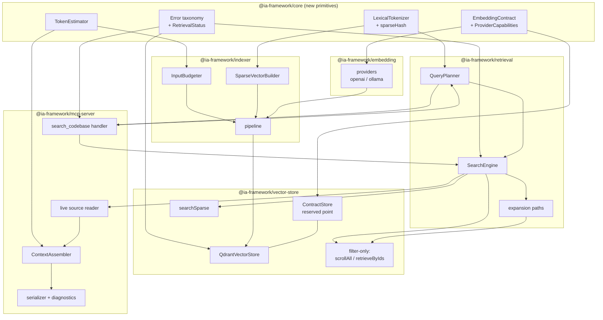

# RAG Correctness, Deterministic Query Planning, and Exact Token-Efficient Context Delivery — Design

**Spec**: `.specs/features/019-rag-correctness-exact-context/spec.md`
**Context**: `.specs/features/019-rag-correctness-exact-context/CONTEXT.md`
**Status**: Draft — awaiting approval
**Scope tier**: Complex (9 workstreams, 105 requirements, 6 packages, one mandatory re-index boundary)

---

## Approach Selection (confirmed with user)

Four architectural decisions were put to the user before components were detailed. All four
recommendations were accepted:

| # | Decision | Chosen | Rejected |
| --- | --- | --- | --- |
| AP-1 | Structural placement of shared contracts | Primitives in `core`; plan in `retrieval`; assembler in `mcp-server` | New `@ia-framework/context` package (degenerates into this plus a cycle); fix-in-place with duplicated tokenizer (violates A-16) |
| AP-2 | `intent` taxonomy | Derived from the **answer shape** the assembler must produce | Reuse MCP `keyword\|semantic\|existence\|aggregation` as intent (describes mechanics, not shape — would force a third classifier); single collapsed enum (violates A-17) |
| AP-3 | Embedding-contract storage | **Reserved metadata point inside the collection** | `indexing-state.json` (local file vs. possibly-remote collection → fail-wrong instead of fail-closed); both cross-checked (undefined third failure mode) |
| AP-4 | Source of A-28's expanded range | **Extend `CodeChunk` with doc-comment/annotation start lines at index time** | Backward text scan at query time (heuristic, per-language variance); ignore A-28 (non-compliant) |

---

## Research Findings That Shape the Design

Recorded because three of them invalidate the obvious implementation and one closes a spec gap.

### F1 — The sparse channel is broken on **both** sides, not just the missing method

The query side and the index side use different hash projections of the same djb2 accumulator:

- query: `hash & 0x7fffffff` → `[0, 2³¹-1]` (`packages/retrieval/src/search-engine.ts:1002`)
- index: `hash % 65536` → `[0, 65535]` (`packages/indexer/src/embedder.ts:84`)

They also disagree on tokenization: the query side lowercases **before** splitting
(`search-engine.ts:963-966`, so `getUserById` → one token `getuserbyid`), while the index side
splits camelCase **then** lowercases (`embedder.ts:61-73`) and additionally de-duplicates per
source string, capping TF at 1.

**Consequence:** implementing `searchSparse` alone would still retrieve almost nothing, because
a term's query index and its indexed index essentially never coincide. WS2 therefore requires one
shared tokenizer **and** one shared hash used by both packages, plus a full re-index. A-27 already
mandates that re-index, so this costs nothing additional. This is also why SPR-09 and A-16 are
load-bearing rather than cosmetic.

### F2 — Qdrant `order_by` cannot satisfy FLT-03 and FLT-05 simultaneously

Verified against current Qdrant documentation (Points → "Order Points by Payload Key",
*available as of v1.8.0*):

> "When you use the `order_by` parameter, pagination is disabled."

> "When sorting is based on a non-unique value, it is not possible to rely on an ID offset. Thus,
> next_page_offset is not returned within the response."

> "Qdrant therefore requires a payload index which supports Range filtering conditions on the
> field used for `order_by`"

Multi-key ordering is **not documented** on that page, and `(repo, relativePath, startLine)` is
inherently multi-key and non-unique.

**Consequence:** FLT-05's deterministic ordering MUST be a **client-side sort applied after
ID-cursor pagination to exhaustion** (`next_page_offset === null` signals the last page). Using
`order_by` would forfeit FLT-03 (complete pagination). This is recorded as TD-04.

### F3 — `searchHybrid` sends the same dense vector to both prefetch branches

`packages/vector-store/src/qdrant.ts:337-352` uses `options.denseVector` for **both** the
`semantic` and the `signature` prefetch. QP-08 (structural signature representation) therefore
needs a **second dense vector parameter** on the store API, not merely a different query string
upstream. Same root cause as `search-engine.ts:290-291` embedding once and reusing it.

### F4 — `CodeChunk` has no doc-comment or annotation line offsets

`packages/ast-parser/src/types.ts:36,38` carries only `startLine`/`endLine`. Repo-wide there is
no `docCommentStart`, `annotationStart`, `signatureStart`, or persisted `bodyStart`. `bodyStartRow`
exists only as a local variable inside the Java parser (`packages/ast-parser/src/parsers/java.ts:362-367`)
and the splitter (`packages/ast-parser/src/splitter.ts:14,21-33`). A-28 is therefore **not
satisfiable from the current payload** — hence AP-4.

### F5 — `function`/`method` chunks are currently exempt from splitting

`packages/ast-parser/src/splitter.ts:310-312` deliberately never splits a `function`/`method`
chunk ("Never split mid-body … semantic integrity"), emitting it oversized instead. This is
exactly the input class A-29's signature-only fallback exists to handle, and it confirms the
fallback is reachable in practice rather than theoretical.

### F6 — Confirmed spec assumptions

| Assumption | Verdict | Evidence |
| --- | --- | --- |
| A-26 — context-source chunks lack `repoId` | **Confirmed**; concept chunks too | `packages/indexer/src/pipeline.ts:736-754`, `:811-824` vs. `:350` |
| Budget is inoperative | **Confirmed** | cap at `search-codebase.ts:996-1006` reads `r.content`; live read assigns it at `:1044`; `content` is `''` because `search-engine.ts:74` coerces the absent payload field |
| `prefixes` is stripped by config load | **Confirmed** | absent from `packages/core/src/config/schema.ts:3-9`; Zod `z.object` defaults to strip; `.ia-framework/project.json` currently sets it and it is silently discarded |
| No `searchKeyword` in production | **Confirmed** | `VectorStore` (`packages/vector-store/src/interface.ts:207-281`) has 10 methods, none sparse; both consumer guards (`search-engine.ts:311`, `:660`) are permanently false |
| No index-generation concept exists | **Confirmed** | zero hits for `indexGeneration`/`collectionMeta`/`schemaVersion` in `packages/**` |
| CLI does not exit non-zero on skipped chunks | **Confirmed** | `packages/cli/src/commands/index.command.ts:625-633` warns, then falls through to success |

### F7 — Library contracts re-verified (Context7, current)

- **Qdrant JS** — `scroll(collection, { filter, limit, offset, with_payload, with_vector, order_by })`
  returns `{ points, next_page_offset }`; `retrieve(collection, { ids, with_payload })` exists;
  `search()` accepts a named **sparse** vector query; fusion enum is `"rrf" | "dbsf"`.
  `CreateCollection` accepts only `vectors`, `shard_number`, `sharding_method`,
  `replication_factor`, `write_consistency_factor`, `on_disk_payload`, `hnsw_config`,
  `optimizers_config`, `wal_config`, `quantization_config`, `sparse_vectors`,
  `strict_mode_config` — **there is no arbitrary-metadata field**, which is why AP-3 was needed.
- **Sparse vectors** — "The `indices` and `values` arrays must have the same length. And the
  `indices` must be unique." … "If the `indices` are not sorted, Qdrant will sort them internally
  so you may not rely on the order of the elements." (SPR-10.)
- **OpenAI / Ollama** — as recorded in `spec.md` "Library Contracts Verified"; no change found.

---

## Architecture Overview

Nine workstreams reduce to **four architectural moves**. Everything else is a consequence.

1. **Make the embedding contract a first-class, persisted, verified object** (WS1) — one
   `EmbeddingContract` produced from config, applied on every request, validated on every
   response, written into the collection as a reserved point, and checked before any search.
2. **Replace faked primitives with real ones** (WS2, WS3, WS4) — a real sparse search, real
   filter-only retrieval, and real input sizing, all sharing one lexical tokenizer and one
   size estimator from `core`.
3. **Compute one plan, once** (WS5, WS6) — a deterministic `QueryPlan` carrying `intent` and
   `branches` as orthogonal fields, consumed by both `mcp-server` and `SearchEngine`, with
   enrichment carried end-to-end on `RetrievalResult`.
4. **Move the budget to the end** (WS7, WS8, WS9) — a `ContextAssembler` that runs **after**
   live reads, selects smallest-sufficient ranges by a priority ladder, and enforces the budget
   on the **serialized** response.



### The one ordering rule that fixes WS7/WS8

The current pipeline is:

```
retrieve → expand → dedup(chunkId) → BM25 → threshold → TOKEN CAP → live read → format → return
                                                          ^^^^^^^^^ measures '' — inert
```

The design inverts the last four stages:

```
retrieve → expand → dedup+merge → rank → live read → ASSEMBLE (range select + priority ladder)
        → serialize → MEASURE serialized text + structuredContent → enforce → return
```

`applyTokenCap` (candidate-list trimming on stored content) is **retired**; `CandidateLimits`
takes over its internal role (CTX-01) and `ContextAssembler` owns the model-visible budget
(BUD-05, BUD-12).

---

## Code Reuse Analysis

### Existing components to leverage

| Component | Location | How to use |
| --- | --- | --- |
| `bm25-reranker` tokenizer (splits camelCase **before** lowercasing) | `packages/retrieval/src/bm25-reranker.ts:29-41` | **Promote to `core` as the canonical `LexicalTokenizer`** — it is already the only correct one of the three. Reranker then imports it back. Satisfies SPR-08, SPR-09, A-16 |
| `tokenize` + `hashToken` | `packages/indexer/src/embedder.ts:56-85` | Delete; replace with the `core` tokenizer + shared hash. Its camelCase split is right, its `% 65536` projection and per-source dedup are not |
| `computeTermFrequencySparseVector` | `packages/retrieval/src/search-engine.ts:958-991` | Delete; replace with shared `buildSparseVector` from `core`. Keeps collision-summing behavior (already correct for SPR-10) |
| `adaptive-budget.ts` tiers 8000/20000/40000 | `packages/mcp-server/src/tools/adaptive-budget.ts:31-35` | **Retain verbatim** as the adaptive default (context.md decision 6 forbids new numbers). Only precedence changes |
| `classifyQuery` (MCP) + `DEFAULT_RULES` regexes | `packages/mcp-server/src/classification/query-classifier.ts:26-126` | Harvest the regex corpus as **evidence extractors** feeding `QueryPlanner`; retire it as a standalone classifier (QP-04) |
| `classifyQuery` + `getVectorsForQueryType` (retrieval) | `packages/retrieval/src/query-classifier.ts:51-105` | Harvest the vector-selection mapping into `QueryPlanner.branches`; retire as standalone (QP-04) |
| `analyzeRetrievalQuery` | `packages/retrieval/src/query-intelligence.ts:12-33` | Fold into `QueryPlanner` evidence. Note **three copies exist** (`retrieval`, `core/src/retrieval`, `mcp-server/src/tools/result-formatting.ts:19-37`) — collapse to one |
| `search-synonyms.ts` curated map | `packages/retrieval/src/search-synonyms.ts` | Sparse channel only, additive only (QP-10, A-07). No change to the map itself |
| `[OLD_SCHEMA]` guard pattern | `packages/vector-store/src/qdrant.ts:198-208` | **The template for EMB-09/EMB-10/A-27**: sentinel-prefixed, actionable, names the remediation flag. Upgrade to a typed error and reuse the posture |
| `formatOllamaError` / `categorizeOllamaError` | `packages/indexer/src/errors/ollama-errors.ts:8-122` | The house pattern for actionable multi-line `Suggestion:` messages. Its `phase` field already includes `'embedding'` yet no embedding code uses it — wire it up (FAIL-01) |
| `ConfigNotFoundError` pattern | `packages/core/src/config/loader.ts:5-10` | The error-class shape to follow: `extends Error`, `public readonly` context fields, `this.name` |
| `estimateTokens` | `packages/mcp-server/src/tools/token-cap.ts:23-25` | Promote to `core` as `TokenEstimator`, then **calibrate** for BUD-13's margin. `ceil(len/4)` under-reports on dense code/CJK |
| `contentHash` drift detection | `packages/mcp-server/src/tools/search-codebase.ts:1036-1043` | Reuse unchanged for FAIL-05; move into the assembler so results 6+ are also checked |
| `readFileFn` closure | `packages/mcp-server/src/server.ts:197-213` | Reuse; must gain path-traversal validation (see Risks) and become batched rather than 5 serial awaits |
| `groupByRepo`, `formatRetrievalContext`, `buildCodeAnchor` | `search-codebase.ts:488-502`, `result-formatting.ts:49-67` | Reuse as the assembler's anchor/rendering primitives (CTX-10) |
| `rrf.ts`, `mmr.ts`, `elbow-detection.ts` | `packages/retrieval/src/` | Unchanged. Only their **inputs** are corrected (spec Out of Scope) |
| `incremental.ts` state map keyed `collection[:repoId]` | `packages/indexer/src/incremental.ts:8-30,66` | Reuse the key convention for the **local mirror** of `indexGeneration`; the authoritative copy is the reserved point |
| `ia index -f, --force` | `packages/cli/src/commands/index.command.ts:146` | The remediation named by every refusal message. Real existing flag — no new flag invented |
| `splitOversizedChunks` | `packages/ast-parser/src/splitter.ts:294-321` | The AST-boundary splitter INP-04 requires. Extend, do not replace; `$partN` identity/parent preservation (`:76-92`) already satisfies INP-07 |
| `withDegradation` | `packages/mcp-server/src/capabilities.ts:56-67` | Reuse for FAIL-08 degradation reporting |

### Integration points

| System | Integration method |
| --- | --- |
| Qdrant collection | Gains one reserved contract point + 6→N payload indexes. Vector geometry unchanged (`semantic`, `signature` dense; `sparse` with `modifier: 'idf'`) |
| OpenAI `/v1/embeddings` | Request gains `dimensions` when the model supports it (capability table) |
| Ollama `/api/embed` | Request gains `truncate: false` (A-02) and `dimensions`; `/api/show` reused for native-dimension discovery (already used at `packages/embedding/src/factory.ts:68`) |
| `ChunkPayload` | Additive fields only (`docCommentStartLine`, `annotationStartLine`, `signatureOnly`, `tokenizerVersion`); existing decode gaps closed (FLT-11) |
| `AGENTS.md` injected guidance | `RAG_CONTENT` template at `packages/cli/src/commands/agents.command.ts:10-294`; the stale claim is line **156** (DOC-01) |
| MCP tool surface | Unchanged: `search_codebase`, `get_file`, `get_dependencies`. `search_codebase` description at `search-codebase.ts:1140` also carries the stale top-5 claim |
| Dashboard / `packages/benchmark` | **Untouched.** Dashboard reads `metrics.sqlite` and `indexing-state.json`; both keep their existing shape |

---

## Components

### WS1 — Embedding contract

#### `EmbeddingContract` + `ProviderCapabilities` (new)

- **Purpose**: One value object describing what a vector *is*, plus the per-model rules that
  decide whether the configured dimension is even legal.
- **Location**: `packages/core/src/embedding/contract.ts`, `.../capabilities.ts`
- **Interfaces**:
  - `resolveContract(cfg: EmbeddingProviderConfig): EmbeddingContract` — throws
    `EmbeddingConfigurationError` when the model cannot honor `dimensions` (EMB-02)
  - `capabilitiesFor(provider, model): ModelCapabilities` — `{ supportsDimensionParam,
    nativeDimension?, maxInputTokens, maxBatchItems?, maxRequestTokens? }` (A-01, A-03)
  - `contractsMatch(a, b): ContractDiff | null` (EMB-09)
  - `contractFingerprint(c): string` — stable hash for cache keys (BUD-14)
- **Dependencies**: none (pure)
- **Reuses**: `DEFAULT_DIMENSIONS` table (`packages/embedding/src/factory.ts:7-17`) as the seed
  for `nativeDimension`; OpenAI limits from spec's verified contracts (8192/input, 2048 items,
  300 000 tokens/request)

> **Fix required alongside**: add `prefixes` to `EmbeddingProviderConfigSchema`
> (`packages/core/src/config/schema.ts:3-9`) — it is currently stripped, which is the whole of
> EMB-07. The `as ProjectConfig` cast at `loader.ts:24` is what hides this from TypeScript.

#### `EmbeddingProvider` (modified)

- **Purpose**: Apply the contract on every request; validate every response before it can be
  stored or searched.
- **Location**: `packages/embedding/src/providers/{openai,ollama}.ts`, `interface.ts`
- **Interfaces** (interface gains two members; both existing methods keep their signatures):
  - `readonly contract: EmbeddingContract`
  - `embedBatch(texts, taskType?): Promise<EmbedBatchOutcome>` where
    `EmbedBatchOutcome = { vectors: (number[] | null)[]; failures: InputFailure[] }` — per-input
    failure granularity (EMB-06, INP-09, A-20)
  - `applyPrefix` promoted to one shared helper (currently duplicated verbatim at
    `openai.ts:32-36` and `ollama.ts:28-32`)
- **Dependencies**: `core` contract + capabilities; `formatOllamaError`
- **Reuses**: OpenAI's existing `data[].index` re-sort (`openai.ts:57`) — Ollama has **no**
  equivalent and needs a length check (`ollama.ts:49-50` returns raw)
- **Note**: `EmbedBatchOutcome` is a breaking change for the 3 structural duplicates of the
  provider type (`indexer/src/embedder.ts:37-41`, `retrieval/src/types.ts:105-108`, and the test
  mock factory at `packages/embedding/src/caching-provider.test.ts:1-24`, which is annotated
  `: EmbeddingProvider` and will fail compilation until updated — an intentional tripwire).

#### `ContractStore` (new) — AP-3

- **Purpose**: Persist and read the contract as a reserved point **inside** the collection, so it
  cannot desync from the vectors it describes.
- **Location**: `packages/vector-store/src/contract-store.ts`
- **Interfaces**:
  - `writeContract(c: EmbeddingContract, generation: string): Promise<void>` — upsert at a fixed
    deterministic UUID with payload `{ kind: '__ia_contract__', provider, model, dimension,
    prefixes, tokenizerVersion, sparseHashVersion, indexGeneration, writtenAt }`
  - `readContract(): Promise<StoredContract | 'unknown'>` — via `client.retrieve({ ids: [ID] })`
  - `assertSearchable(active: EmbeddingContract): void` — throws
    `EmbeddingContractMismatchError` or `UnknownContractError` (EMB-09, A-27)
- **Dependencies**: Qdrant client, `core` contract
- **Reuses**: `toQdrantId` hashing convention (`qdrant.ts:13-22`)
- **Obligation this creates (must be tested)**: every search, scroll, and count filter must
  exclude the reserved point via `must_not: [{ key: 'kind', match: { value: '__ia_contract__' } }]`.
  Centralized in one `baseFilter()` helper so it cannot be forgotten per-call-site.

#### `initialize()` (modified) — EMB-10, EMB-11, A-14, FLT-09

Current behavior deletes the collection on dimension mismatch with **no `force`, no prompt, no
log** (`qdrant.ts:218-222`) — the opposite of its old-schema sibling. New behavior:

| State | Behavior |
| --- | --- |
| Collection absent | Create + write contract + create payload indexes |
| Old schema (`text`/`code` vectors present) | Unchanged: `[OLD_SCHEMA]` error unless `force` |
| Declared sizes match, contract matches | No-op — **but still reconcile payload indexes** (today it returns at `:221` before the index loop, so existing collections never get missing indexes) |
| Declared sizes mismatch, no `force` | **Typed actionable error, no delete** (EMB-10) |
| Declared sizes unreadable | **Treated as mismatch, fail closed** (EMB-11) — today `undefined` short-circuits to "no mismatch" and silently no-ops |
| Contract absent | `UnknownContractError` on search; `ia index --force` remediates (A-27) |

### WS2 — Sparse retrieval

#### `LexicalTokenizer` + `buildSparseVector` (new, shared)

- **Purpose**: The single definition of "what a token is", used by the sparse channel, the BM25
  reranker, and lexical similarity (A-16, SPR-09).
- **Location**: `packages/core/src/lexical/tokenizer.ts`, `.../sparse.ts`
- **Interfaces**:
  - `tokenize(text: string): string[]` — split identifier case boundaries **before** lowercasing;
    preserve quoted phrases as single terms; handle dot/path/package/annotation forms
  - `buildSparseVector(sources: TokenSource[]): SparseVector` — unique ascending indices,
    collision weights summed (SPR-10)
  - `TOKENIZER_VERSION`, `SPARSE_HASH_VERSION` — participate in the contract, so a tokenizer
    change refuses stale collections instead of silently mis-matching
- **Dependencies**: none (pure)
- **Reuses**: `bm25-reranker.ts:29-41` as the base implementation
- **Replaces**: `search-engine.ts:958-1003` and `embedder.ts:56-85`
- **Acceptance anchor**: `getUserById` must yield identical terms from both call sites
  (spec Success Criteria).

#### `searchSparse` on `VectorStore` (new) — SPR-01..SPR-06

- **Purpose**: The missing production method. `VectorStore` today has 10 methods, none sparse.
- **Location**: `packages/vector-store/src/{interface,qdrant}.ts`
- **Interfaces**:
  - `searchSparse(v: SparseVector, o: SparseSearchOptions): Promise<SearchResult[]>` — named
    sparse vector query, applies repo filter + metadata filters + limit (SPR-03)
  - `capabilities(): StoreCapabilities` — `{ sparse: boolean; filterOnly: boolean;
    payloadIndexes: string[] }` (A-04, SPR-06)
- **Dependencies**: Qdrant client
- **Behavioral requirement**: `vectorName` provenance must be **real**. Today `searchHybrid`
  hard-codes `vectorName: 'semantic'` on every hit (`qdrant.ts:368`), destroying branch
  provenance that SPR-07 requires reporting.
- **Empty vs. failure**: an empty sparse vector (no surviving tokens) → branch **skipped and
  reported skipped**, never "executed with 0 results" (spec Edge Cases).

#### `searchHybrid` (modified) — F3, SPR-07, SPR-11

- Gains a **second** dense parameter: `{ semanticVector, signatureVector, sparseVector }`, so the
  signature prefetch is actually structural.
- Result mapping must carry per-branch provenance.
- Must reach behavioral parity with the routed path for test exclusion, diversity, and elbow
  truncation (SPR-11, A-22) — today `searchHybrid` skips all three.

### WS3 — Filter-only retrieval and expansion

#### `FilterOnlyRetriever` (new) — FLT-01..FLT-05, F2

- **Purpose**: Replace all six zero-vector fakes with deterministic primitives.
- **Location**: `packages/vector-store/src/filter-only.ts`
- **Interfaces**:
  - `scrollAll(filter, opts: { ceiling: number }): Promise<{ points; truncated: boolean }>` —
    pages on `next_page_offset` until `null` or the ceiling; `truncated` is **reported**, never
    silent (FLT-03, FLT-04, A-05)
  - `retrieveByIds(ids): Promise<Point[]>` — for known-id lookups (adjacent chunks)
  - `orderDeterministically(points): Point[]` — **client-side** sort by
    `(repoId, relativePath, startLine)` (FLT-05; `order_by` is unusable per F2)
- **Dependencies**: Qdrant client
- **Replaces** all six sites, each of which also gains repo + filter threading:

| Site | Method | Current limit heuristic | Current filter threading |
| --- | --- | --- | --- |
| `search-engine.ts:485` | `fetchChunksForFiles` (dead code — delete) | `filePaths.length * 50` | none |
| `search-engine.ts:511` | `fetchChunksForRelativePaths` | `relativePaths.length * 50` | none |
| `search-engine.ts:549` | `getAdjacentChunks` | `indices.length` | none |
| `search-engine.ts:594` | `expandCallChain` | `min(n*2, 20)` | none |
| `search-engine.ts:808` | `getFile` | hardcoded `1000` | `repoId` only |
| `search-engine.ts:933` | `findImplementations` | hardcoded `10` | none |

Note `findImplementations` also builds two **independent** `must` clauses on
`dependencyEdges[].targetPath` and `.relation` despite a comment claiming a nested filter — so
the two conditions can match *different* array elements. Use a real Qdrant `nested` filter.

#### `EffectiveFilter` (new) — FLT-06, FLT-07, A-15, FAIL-03

- **Purpose**: Make repo isolation and user filters **structurally unforgeable** rather than
  best-effort at the MCP boundary.
- **Location**: `packages/retrieval/src/effective-filter.ts`
- **Interfaces**: `EffectiveFilter` = `{ repoId?, userFilters, excludeTests, reservedExclusion }`;
  `toQdrantFilter(): Record<string, unknown>`
- **Enforcement mechanism**: every retrieval/expansion method takes `EffectiveFilter` as a
  **required** parameter. Five of eight expansion paths currently accept no filter argument at
  all, so the compiler — not a reviewer — enforces threading. This is the design's answer to
  "test-verified, not best-effort".
- **Known boundary (A-26)**: context-source and concept chunks are written **without** `repoId`
  (`pipeline.ts:736-754`, `:811-824`). Repo isolation guarantees apply to **code chunks**; this
  gap is recorded, not silently assumed fixed. It also means the existing CLI orphan check
  (`index.command.ts:652-666`) will always report them.

#### Payload decode completeness (modified) — FLT-11, FLT-12

`toChunkPayload` (`qdrant.ts:28-159`) decodes 43 fields but **not** `annotationMeta`,
`chunkIndex`, `totalChunks`, `calledBy` — all four are written (`pipeline.ts:342-343,348-349`,
`:355`). Consequences: `getAdjacentChunks` sorts by `chunkIndex` that always decodes to
`undefined` → `?? 0` → constant (FLT-12), and the `calledBy` half of call-chain expansion is
dead. Decode must round-trip everything the contract declares, asserted by a property test over
the field list.

### WS4 — Embedding input safety

#### `InputBudgeter` (new) — INP-01..INP-03

- **Purpose**: Refuse or repack **before** the request, per model limits.
- **Location**: `packages/indexer/src/embedding/input-budgeter.ts`
- **Interfaces**: `packBatches(inputs: SizedInput[], caps: ModelCapabilities): Batch[]` —
  respects per-input tokens, max item count, and request-wide total (A-03); repacks an oversized
  *batch* rather than rejecting it (spec Edge Cases)
- **Replaces**: fixed `embeddingBatchSize = 50` slicing at `pipeline.ts:657-661` and `:725-726`
- **Reuses**: `TokenEstimator` from `core` — note the existing `estimateTokens` is on the provider
  interface, implemented twice, and **never called in production**

#### `OversizedInputHandler` (new) — INP-04..INP-07, A-19, A-29

Deterministic ladder, in order:

1. Split at AST/semantic boundaries via extended `splitOversizedChunks` — preserving identity,
   line ranges, signature, parent name, repo metadata (INP-07, already the `$partN` behavior)
2. If still oversized: **signature-only fallback** — embed signature + doc comment, persist the
   **full true line range**, mark the point `signatureOnly: true` (A-29)
3. If neither: actionable error identifying the chunk (never a silent drop)

Text truncation is **rejected** (stores a vector for text that is not the chunk — the A-02
corruption class). Mechanical line splitting is **rejected** (semantically incoherent vectors).
F5 confirms `method`/`function` chunks reach step 2 in practice.

#### `IndexRunSummary` (modified) — INP-11, A-29

- Gains per-input skip records: `{ repoId, relativePath, name, startLine, endLine, reason }` —
  enough identity to re-index. Today only a **count** survives (`pipeline.ts:867-871`), with no
  identity, and batch-granular loss discards up to 50 siblings (`pipeline.ts:696`).
- Adds a `signatureOnly` count + identity list.
- **CLI exits non-zero** when any chunk was skipped (A-29). Today it warns and exits 0
  (`index.command.ts:625-633`).
- Cancellation must not leave points whose recorded contract disagrees with their vector
  (INP-10) — write the contract point **before** any chunk point, and treat cancel as
  stop-before-upsert.

### WS5 — Deterministic query planning

#### `QueryPlanner` (new) — the centerpiece of QP-01..QP-13

- **Purpose**: Compute exactly one plan per request. Pure, local, reproducible, no LLM, no network.
- **Location**: `packages/retrieval/src/planning/query-planner.ts`; plan **type** exported from
  `core` so `mcp-server` needs no retrieval-internal import for the shape
- **Interfaces**: `plan(input: PlanInput, caps: StoreCapabilities): QueryPlan` — throws
  `QueryPlanError` rather than defaulting away user constraints (QP-13)
- **Dependencies**: `LexicalTokenizer`, synonym map, `EffectiveFilter`, `StoreCapabilities`
- **Reuses**: regex corpora from **both** retired classifiers, plus `analyzeRetrievalQuery`
- **Determinism**: no `Date.now()`, no `Math.random()`, no iteration over unordered sets without
  a sort. Asserted by a same-input-twice equality test (QP-05).

**`intent` taxonomy (AP-2)** — each value maps 1:1 to an assembly shape already fixed in
context.md decision 3:

| `intent` | Assembly shape | Requirement |
| --- | --- | --- |
| `exact_symbol` | Construct node + doc comment + annotations + anchor | CTX-05, A-28 |
| `class_overview` | Class decl (incl. `extends`/`implements`) + field block + method **signatures**; bodies only for implicated members | CTX-06 |
| `conceptual` | Ranked chunks: bodies at the top, signature-or-summary below, until budget spent | CTX-07 |
| `dependency_trace` | Compact evidence + **import block included** (the only intent that includes it) | CTX-08, ENR-04 |
| `existence` | Source-free: anchors + metadata; fully budget-accounted | BUD-16, A-18 |
| `aggregation` | Source-free: grouped anchors; fully budget-accounted | BUD-16, A-18 |

`branches` is computed **separately** from lexical evidence and gated by
`StoreCapabilities.sparse` (SPR-06) — a `conceptual` query with a quoted term still gets the
sparse branch, which is precisely why A-17 requires two fields.

**Three channel representations** (QP-07..QP-09, A-06), all derived from one preserved verbatim
query (QP-02):

- `semantic` = original text + configured **query** prefix (meaning-preserving)
- `signature` = structural rendering: exact symbols, class/method names, package names, paths,
  annotations, construct types
- `sparse` = exact identifiers, quoted terms, package/path tokens + bounded additive synonyms

Templates are **output scaffolding only** and must never enter an embedding input (QP-11) —
today `registry.ts`/`intent-detector.ts` output is prepended to the response text only, which is
already correct and must stay that way.

### WS6 — Enrichment propagation

#### `RetrievalResult` (modified) — ENR-01, ENR-06, ENR-08

Enrichment is severed at the `ChunkPayload → RetrievalResult` boundary: `toRetrievalResult`
(`search-engine.ts:56-99`) copies 27 fields and drops `description`, `businessContext`,
`semanticTags`, `relationships`, plus `stereotype`, `archLayer`, `signature`, `classSignature`,
`contextHeader`, `moduleInfo`, `parentName`, `visibility`, `annotations`, `annotationMeta`,
`complexity`, `serviceBoundary`, `qualityScore`, `enrichedAt`, `enrichmentModel`. `mcp-server`
has **zero** references to the enrichment names.

- Add `enrichment?: { description?, businessContext?, semanticTags?, relationships?, enrichedAt?,
  enrichmentModel? }` — one optional group, absent rather than empty when unenriched (ENR-08)
- Add the AST/classification fields the assembler needs: `signature`, `classSignature`,
  `parentName`, `stereotype`, `archLayer`, `docCommentStartLine`, `annotationStartLine`,
  `signatureOnly`
- Must survive **multi-collection merge** too (`multi-collection-search-engine.ts`) and every
  expansion path (ENR-01, ENR-09)
- **No LLM call at query time** (ENR-02) — enrichment is read-only at retrieval

**Presentation** (context.md decision 5): expansion results render `anchor + signature +
one-line description` in prose, with tags/context/relationships in `structuredContent` only;
direct results carrying live source render **source only** in prose (paying twice for the same
information is the thing being avoided); missing enrichment omits the line entirely.

### WS7 — Exact context assembly

#### `ContextAssembler` (new) — the user-visible payoff

- **Purpose**: Turn ranked results + live source into the smallest sufficient model-visible
  context, ordered by priority, inside the budget.
- **Location**: `packages/mcp-server/src/context/assembler.ts`
- **Interfaces**:
  - `assemble(input: AssemblyInput): AssembledContext` where `AssemblyInput = { plan, results,
    liveSource, budget }` and `AssembledContext = { items: ContextItem[]; diagnostics:
    Diagnostics; overflow?: OverflowReport }`
  - `selectRange(result, intent): LineRange` — smallest sufficient range (CTX-03)
  - `mergeOverlaps(ranges): LineRange[]` — deterministic, safe-only (CTX-14)
- **Dependencies**: `TokenEstimator`, anchor/format helpers, `QueryPlan`
- **Runs strictly after** retrieval, expansion, live reads, enrichment propagation (CTX-02)

**Range selection for `exact_symbol` (A-28)** uses the new index-time fields (AP-4):
`[min(docCommentStartLine, annotationStartLine, startLine) .. endLine]`. Overlap detection and
merging operate on these **expanded** ranges, not bare bodies. No enclosing-class breadcrumb —
CTX-10's mandatory anchor already carries repo, path, symbol, and line range.

**Deduplication (CTX-13)** must cover all six classes; today every one of the five dedup sites is
`chunkId`-only:

1. identical `chunkId`
2. same source region from **different collections** (AST vs. LLM) — key on
   `(repoId, relativePath, startLine, endLine)`
3. repeated files
4. **overlapping line ranges** → merge (CTX-14)
5. repeated expansion results
6. repeated summaries/anchors

Ranking order and provenance of survivors are preserved (CTX-15).

**`get_file` is unchanged** (CTX-11, CTX-12, A-10): path-only may return the full file; `name` or
range returns only the requested portions. Only `search_codebase` loses whole-file responses.

#### `CandidateLimits` (new) — CTX-01, CTX-16

Internal candidate counts (`limit * mmrCandidateMultiplier`, prefetch multipliers) become
explicitly separate from the model-visible budget. The hardcoded `topN = 5`
(`search-codebase.ts:1025`) is **deleted**; live-source inclusion follows priority + remaining
budget (A-12). This is the behavior change DOC-01 must document.

#### `LiveSourceReader` (modified) — CTX-09, FAIL-04, FAIL-05

- Reads candidate ranges **before** assembly, batched per file (today: up to 5 serial awaits at
  `search-codebase.ts:1028-1048`)
- A read failure degrades the item to **anchor + metadata, marked** — never silently omitted
  (spec Edge Cases). Today `catch {}` at `:1045` falls back to stored content, which is `''`, so
  a failed read is indistinguishable from a deliberately stripped result
- Drift check applies to **every** included item, not only the top 5

### WS8 — Final budget contract

#### `BudgetGovernor` (new) — BUD-01..BUD-16

- **Purpose**: One contract governing every route, measured on the **serialized** response.
- **Location**: `packages/mcp-server/src/context/budget.ts`
- **Interfaces**:
  - `resolve(input, adaptive): ResolvedBudget` — **explicit per-call always wins**, even when
    larger (context.md decision 6). `0` = unlimited (still report true estimate); negative or
    non-numeric = configuration error
  - `reserveDiagnostics(): number` — fixed conservative allowance taken **up front** (A-24)
  - `enforce(items, budget): { included, compacted, omitted, overflow? }`
- **Priority ladder** (BUD-07), applied identically on every route:
  1. exact requested symbol / AST node
  2. direct high-confidence evidence
  3. exact identifier matches
  4. compact enriched summaries
  5. dependency + hierarchy evidence
  6. adjacent + call-chain evidence
  7. diagnostics (pre-reserved)
- **One-node overflow (BUD-08, A-09)**: if the single highest-priority exact node alone exceeds
  the remaining budget → include it **complete**, omit all lower priority, set
  `exact_node_overflow`, report estimated/configured/overflow amounts. Exactly one node, exactly
  one exception. If that node **cannot be read from disk**, the overflow rule is **not** invoked
  and the failure is reported (spec Edge Cases).
- **Measurement point (BUD-03, BUD-05, BUD-12)**: the serialized text **plus**
  `structuredContent`. Nothing model-visible is uncounted — query echo, headers, anchors, line
  ranges, live source, summaries, templates, fallback notes, diagnostics.

#### `TokenEstimator` (new, calibrated) — BUD-13, A-08

- `ceil(len/4)` **under-reports** dense code and non-ASCII, and BUD-13 forbids under-reporting
  beyond a documented margin. The estimator must be conservative (over-estimating is safe;
  under-estimating is the current failure mode).
- Calibration approach: character-class-weighted estimate, with the **margin asserted by a test**
  over a corpus of real chunks from this repo. No tokenizer dependency is introduced (A-08).
- The concrete margin value and the diagnostics reservation constant are Tasks-phase calibration;
  the *shape* is fixed here.

#### Session cache (modified) — BUD-14, A-23

Current key is `sha256(JSON.stringify(input))` with **no TTL and no generation**, so a re-index
serves stale answers indefinitely. New key components: original query, plan fingerprint,
effective filters, expansion settings, effective budget, tool options, **and `indexGeneration`**
read from the contract point. Two requests differing only in expansion or budget must not share
an entry. Also fix: the cache currently stores `responseText` but returns only a short
"same results as previous query" message (`search-codebase.ts:514-526`).

#### `Diagnostics` (new) — BUD-04, BUD-15, A-24

All 13 fields, on **every** response, on **every** route, in `structuredContent` **only**
(context.md decision 4): `route`, `executed_branches`, `fallback_mode`, `candidate_count`,
`selected_count`, `deduplicated_count`, `omitted_count`, `expansion_count`, `stale_count`,
`estimated_tokens`, `configured_budget`, `compaction_count`, `exact_node_overflow`.

Prose stays pure evidence, with exactly **two** permitted anomaly lines: a degradation line when
`status != ok` or a capability is degraded (FAIL-08), and an exact-node-overflow line (BUD-08).

Also: `console.info` at `search-codebase.ts:1012` writes to **stdout**, which on a stdio MCP
transport is the JSON-RPC framing channel. Must move to stderr/logger.

### WS9 — Failure and degradation

#### `RetrievalStatus` + error taxonomy (new) — FAIL-01..FAIL-08

- **Purpose**: Make every failure actionable and machine-branchable, without ever returning
  unrelated evidence.
- **Location**: `packages/core/src/errors/` (taxonomy), surfaced by each package
- **Status enum (closed, per context.md decision 2)**:
  `ok | empty | low_confidence | unavailable | refused`
- **Boundary behavior**: a refusal or unavailable-infrastructure outcome is returned as a
  **normal successful tool result** whose body states the failure, cause, and remediation, plus
  the machine-readable status field — **not** an MCP protocol error. A protocol error reaches the
  consuming agent as an opaque "tool failed" wrapper, which is exactly what pushes it back to
  `grep`.
- **Recorded tension (deliberate)**: when Qdrant is genuinely unreachable the framework cannot
  answer. The response states the failure and remediation, does **not** endorse a shell fallback,
  and does **not** imply an answer is available. It must never resolve this by returning
  unrelated evidence (FAIL-02).

**Error classes**, all following the `ConfigNotFoundError` house pattern (`extends Error`,
`public readonly` context fields, `this.name`) with `formatOllamaError`-style multi-line
`Suggestion:` messages:

| Class | Raised when | Requirement |
| --- | --- | --- |
| `EmbeddingConfigurationError` | Unsupported dimension configured | EMB-02 |
| `EmbeddingResponseError` | Malformed / empty / wrong-length vector | EMB-04 |
| `EmbeddingContractMismatchError` | Persisted ≠ active contract | EMB-09 |
| `UnknownContractError` | No contract point on the collection | A-27 |
| `CollectionSchemaError` | Dimension mismatch or unreadable schema | EMB-10, EMB-11 |
| `PayloadIndexError` | Index creation failed | FLT-08 |
| `FilterOnlyRetrievalError` | Filter/pagination failure | FLT-10 |
| `QueryPlanError` | Plan cannot be produced | QP-13 |
| `OversizedInputError` | Neither split nor fallback possible | INP-06 |

**Catch blocks that must stop swallowing:**

| Location | Current | Required |
| --- | --- | --- |
| `qdrant.ts:245-247` | `catch { /* non-fatal */ }` on payload index creation | Report (FLT-08). Note this bare catch is currently **load-bearing for the test suite** — the mock client has no `createPayloadIndex`, so a `TypeError` is silently absorbed |
| `search-codebase.ts:1045-1047` | `catch {}` on live read | Degrade to marked anchor + metadata (FAIL-04) |
| `search-codebase.ts:870-880` | One catch collapsing **all five** expansions | Per-expansion isolation with reported degradation |
| `search-codebase.ts:975-977` | `catch {}` on observability | Acceptable to keep silent; must not mask retrieval failure |
| `pipeline.ts:696-700` | `logger.warn` then drop 50 chunks | Per-input accounting + non-zero exit (INP-09, INP-11) |
| `pipeline.ts:768-769` | Context source failure drops all remaining chunks, unaccounted | Account for skipped chunks |

### P2 — Documentation alignment (DOC-01..DOC-04)

Three places assert the contract this feature replaces, and all three must change together:

| Location | Stale claim |
| --- | --- |
| `packages/cli/src/commands/agents.command.ts:156` | "Top-5 results include live code; results 6-10 are metadata-only to save tokens" |
| `packages/mcp-server/src/tools/search-codebase.ts:1140` | "Top-5 results include live file content; results 6-10 are metadata-only…" |
| `README.md:598` | prose copy of the same claim |

DOC-02 adds diagnostics interpretation; DOC-03 documents the refusal + `ia index --force`
remediation; DOC-04 documents sparse-branch conditionality. Note the `RAG_CONTENT` block is a
single 285-line template literal (`agents.command.ts:10-294`), and the `pipeline-guide` block in
the live `AGENTS.md` has **no generator** — it is hand-maintained and out of scope.

---

## Data Models

```typescript
// @ia-framework/core — embedding contract
interface EmbeddingContract {
  provider: 'openai' | 'ollama'
  model: string
  dimension: number
  prefixes?: { document: string; query: string }
  tokenizerVersion: number
  sparseHashVersion: number
}

interface ModelCapabilities {
  supportsDimensionParam: boolean
  nativeDimension?: number
  maxInputTokens: number
  maxBatchItems?: number
  maxRequestTokens?: number
  disableServerTruncation: boolean // Ollama: send truncate:false (A-02)
}
```

**Relationships**: one `EmbeddingContract` per Qdrant collection, persisted in the reserved
point; `contractFingerprint` participates in the session cache key.

```typescript
// @ia-framework/core — the shared plan
type QueryIntent =
  | 'exact_symbol' | 'class_overview' | 'conceptual'
  | 'dependency_trace' | 'existence' | 'aggregation'

type VectorBranch = 'semantic' | 'signature' | 'sparse'

interface QueryPlan {
  originalQuery: string            // verbatim, never derived from (QP-02)
  intent: QueryIntent              // answer shape
  branches: VectorBranch[]         // orthogonal to intent (A-17)
  representations: {
    semantic: string
    signature: string
    sparse: SparseVector
  }
  lexical: {
    terms: string[]
    exactSymbols: string[]
    quotedTerms: string[]
    packageTerms: string[]
    pathTerms: string[]
  }
  filter: EffectiveFilter
  expansion: { hops: 0 | 1 | 2 }
  budget: ResolvedBudget
  candidateLimits: CandidateLimits // separate from budget (CTX-01)
  templateId?: string              // output scaffolding only (QP-11)
  fingerprint: string              // cache key component (BUD-14)
}
```

**Relationships**: produced once per request; consumed read-only by `mcp-server` and
`SearchEngine`. Re-classification downstream is forbidden (QP-04).

```typescript
// @ia-framework/core — budget + assembly
interface ResolvedBudget {
  limit: number          // 0 = unlimited
  source: 'explicit' | 'adaptive'
  diagnosticsReserve: number
}

interface ContextItem {
  priority: 1|2|3|4|5|6|7          // BUD-07 ladder
  anchor: SourceAnchor              // CTX-10 — always present
  form: 'source' | 'signature' | 'summary' | 'anchor-only'
  range?: LineRange                 // expanded per A-28 for exact_symbol
  text?: string
  provenance: { branch?: VectorBranch; expansionSource?: string; collection?: string }
  stale?: boolean
  signatureOnly?: boolean           // A-29 — embedded semantics reduced
  degraded?: 'read-failed' | 'compacted'
}

interface SourceAnchor {
  repoId?: string
  relativePath: string
  symbol?: string
  startLine: number
  endLine: number
}
```

```typescript
// @ia-framework/vector-store — additive payload fields
interface ChunkPayloadAdditions {
  docCommentStartLine?: number   // AP-4 / A-28
  annotationStartLine?: number   // AP-4 / A-28
  signatureOnly?: boolean        // A-29
  tokenizerVersion?: number      // sparse compatibility
}

interface StoredContract extends EmbeddingContract {
  kind: '__ia_contract__'
  indexGeneration: string        // BUD-14 cache invalidation
  writtenAt: string
}
```

```typescript
// @ia-framework/core — status + diagnostics
type RetrievalStatus = 'ok' | 'empty' | 'low_confidence' | 'unavailable' | 'refused'

interface Diagnostics {
  route: string
  executed_branches: VectorBranch[]   // only branches that ACTUALLY ran (A-04)
  fallback_mode: string | null
  candidate_count: number
  selected_count: number
  deduplicated_count: number
  omitted_count: number
  expansion_count: number
  stale_count: number
  estimated_tokens: number
  configured_budget: number
  compaction_count: number
  exact_node_overflow: boolean
}
```

---

## Error Handling Strategy

| Error scenario | Handling | User impact |
| --- | --- | --- |
| Configured dimension unsupported by model | `EmbeddingConfigurationError` before any network call | Startup/index fails naming provider, model, configured dimension, model behavior |
| Provider returns wrong-length / empty / malformed vector | `EmbeddingResponseError`; no upsert, no search | Error names configured vs. actual dimension |
| Provider would truncate input server-side | `truncate: false` sent; oversized input is a loud failure | Chunk reported, run continues, exit non-zero |
| Batch partially fails | Successes retained; failures listed per input with re-index identity | Summary names each lost chunk |
| Collection contract ≠ active config | `EmbeddingContractMismatchError`; search **refused** | Tool result states both contracts + `ia index --force` |
| Collection has no contract | `UnknownContractError`; search **refused** | Tool result names collection + `ia index --force` |
| Declared dimensions mismatch, no `force` | `CollectionSchemaError`; **collection NOT deleted** | Actionable machine-readable error |
| Declared dimensions unreadable | Treated as mismatch (fail closed) | Same as above |
| Payload index creation fails | `PayloadIndexError` reported | Warning naming field + effect on filtering |
| Payload index missing on existing collection | Auto-added on startup, silent on success (A-27) | None |
| Adapter lacks sparse support | Plan omits the sparse branch; diagnostics report it as not executed | Response notes reduced capability |
| Sparse vector empty (no surviving tokens) | Branch **skipped and reported skipped** | Diagnostics show branch not executed |
| Filter-only pagination hits safety ceiling | `truncated: true` in diagnostics | Response states the set is partial |
| Filter-only retrieval fails | `FilterOnlyRetrievalError`; **no similarity substitution** | Actionable error, no unrelated evidence |
| Live file read fails | Item degrades to marked anchor + metadata | Response says the read failed, still gives anchors |
| Live content differs from indexed | `stale: true`, visibly marked | `[stale]` tag + structured field |
| Plan cannot be produced | `QueryPlanError` | Diagnostic; user constraints never silently dropped |
| Exact top node unreadable from disk | Overflow rule **not** invoked; failure reported | Response states the failure |
| Budget smaller than diagnostics | Diagnostics reduced deterministically, reduction visible | Response notes reduction |
| Every candidate compacted away | Non-zero `candidate_count`, zero `selected_count` | Distinguishable from "no results" |
| Qdrant unreachable | `status: 'unavailable'` as a normal tool result | States failure + remediation; does **not** endorse `grep`; does **not** claim an answer |
| Indexing cancelled mid-run | Stop before upsert; no contract-inconsistent point written | Deterministic partial index |

---

## Risks & Concerns

| Concern | Location (file:line) | Impact | Mitigation |
| --- | --- | --- | --- |
| **Sparse hash spaces incompatible** (F1) | `retrieval/src/search-engine.ts:1002` vs `indexer/src/embedder.ts:84` | Sparse retrieval returns near-nothing even after `searchSparse` lands; a partial fix would look implemented and stay broken | One shared tokenizer + hash in `core`; `sparseHashVersion` in the contract forces refusal on stale collections; golden-vector test asserts both call sites agree on `getUserById` |
| **`order_by` cannot deliver FLT-03 + FLT-05** (F2) | Qdrant docs; `qdrant.ts:396-417` | Choosing `order_by` silently forfeits complete pagination | Client-side sort after ID-cursor pagination; recorded as TD-04; test seeds >1 page and asserts completeness *and* order |
| **Dimension mismatch destroys the collection with no consent** | `vector-store/src/qdrant.ts:218-222` | Unrecoverable data loss on a config typo; asymmetric with its `[OLD_SCHEMA]` sibling | EMB-10: typed error, no delete without `force` (fixed in this feature) |
| **Unreadable schema currently silently no-ops** | `qdrant.ts:210-221` | A `{}`-vector collection passes as "agreed", then every upsert fails at the API layer | EMB-11 fail-closed |
| **Payload indexes only ever created at collection-creation time** | `qdrant.ts:221` returns before `:234-248` | Existing collections never get missing indexes; filtered search silently degrades to full scan | Reconcile indexes on every `initialize()`, including the no-op path |
| **`catch {}` on index creation is load-bearing for tests** | `qdrant.ts:245-247`; mock at `qdrant.test.ts:17-26` lacks `createPayloadIndex` | Removing the swallow breaks currently-green tests; a naive "fix" may re-add it | Add `createPayloadIndex` to the mock in the same task that adds reporting; zero existing test coverage today |
| **Reserved contract point can leak into results** | new `contract-store.ts` | A `__ia_contract__` point surfacing as a search hit would be a visible defect | One centralized `baseFilter()` with `must_not` on `kind`, applied by construction; test asserts no route returns it (including scroll, count, and every expansion) |
| **`EmbedBatchOutcome` breaks 3 structural provider duplicates** | `indexer/src/embedder.ts:37-41`; `retrieval/src/types.ts:105-108`; `embedding/src/caching-provider.test.ts:1-24` | Compile breakage across packages mid-migration | Intentional tripwire — the annotated mock factory fails compilation until updated. Collapse the duplicates onto the canonical interface in the same phase |
| **`?? []` silently substitutes empty vectors** | `indexer/src/embedder.ts:148-149` | A short provider response becomes zero-length vectors upserted with no dimension check | EMB-03/EMB-04 validate before upsert; remove the `?? []` fallback |
| **Enrichment cache is in-memory only** | `indexer/src/enrichment/cache.ts:28-36` | A full re-index (mandated by A-27) re-pays all enrichment LLM cost | Out of scope, but **flag the cost to the user before the migration**; disk cache is a separate feature. `llm-chunk-cache.json` precedent exists |
| **`graph.sqlite` is 3.58 GB on this machine** | `.ia-framework/graph.sqlite` | A full re-index rebuilds `file_edges`; disk/time cost is material | Note in the migration path; `file_edges` is already collection-scoped so it can be rebuilt per collection |
| **Path traversal in the live reader** | `mcp-server/src/server.ts:209` — `join(root, relativePath)` with no validation | A `..` in `relativePath` escapes the repo root; payload values are indexer-controlled today but this is a real gap | Validate the resolved path stays under the repo root in `LiveSourceReader` |
| **`console.info` writes to the MCP stdio framing channel** | `search-codebase.ts:1012` | Can corrupt JSON-RPC framing | Route to stderr/logger during the budget rework |
| **`estimateTokens` under-reports** | `token-cap.ts:23-25` | BUD-13 forbids under-reporting beyond a stated margin; `len/4` fails on dense code and non-ASCII | Calibrated conservative estimator with a **test-asserted** margin over a real-chunk corpus |
| **A-26: context-source + concept chunks have no `repoId`** | `pipeline.ts:736-754`, `:811-824` | Repo isolation cannot hold for them; the CLI orphan check will always flag them | Recorded, not silently assumed fixed. Guarantees scoped to code chunks; indexing-side fix is a separate feature |
| **Existing `getFile` is the only filter path that scopes by repo** | `search-engine.ts:803` | Everything else can bleed cross-repo, and colliding `relativePath` is explicitly expected | `EffectiveFilter` as a **required** parameter makes the compiler the enforcer |
| **`fetchChunksForFiles` is dead code using the deprecated `filePath` key** | `search-engine.ts:475-494` | Maintaining it wastes effort and risks resurrecting a deprecated field | Delete in WS3 rather than port |
| **No integration tests and no gating convention exist** | zero `vitest.config.*`; all deps mocked | Contract behavior against real Qdrant/Ollama stays unverified; a mock can agree with a wrong assumption | Design keeps every requirement assertable against mocks; where real-server behavior is load-bearing (sparse query shape, `next_page_offset`, `order_by` absence) the assumption is pinned to quoted docs in this design |
| **`turbo.json` declares a test input glob matching nothing** | `turbo.json:16-20` | Test-cache keys ignore config that does not exist — harmless now, misleading later | Note only; no change required |
| **9 workstreams in one feature** | — | Large blast radius; a mid-way stop leaves the system inconsistent (e.g. new tokenizer, old index) | Phase order below makes each phase independently shippable; the tokenizer/hash change is gated by the contract so a stale index refuses rather than mis-matches |

---

## Tech Decisions

| Decision | Choice | Rationale |
| --- | --- | --- |
| TD-01 Structural placement | Primitives in `core`, plan in `retrieval`, assembler in `mcp-server` | AP-1. Follows the existing dependency direction; a dedicated package inverts into a cycle because the assembler needs `RetrievalResult` while `retrieval` needs the tokenizer |
| TD-02 `intent` taxonomy | Six values derived from assembly shape | AP-2. Each maps 1:1 to a shape already fixed in context.md decision 3, making CTX-05..CTX-08 testable from the plan. Neither legacy enum survives as the single axis (A-17) |
| TD-03 Contract storage | Reserved point inside the collection | AP-3. Qdrant has no collection-metadata field (verified). Lives and dies with the collection, so a local file cannot assert a contract for a collection that no longer exists |
| TD-04 Deterministic ordering | Client-side sort after ID-cursor pagination; **not** `order_by` | F2. `order_by` disables pagination and returns no `next_page_offset`, which would forfeit FLT-03 |
| TD-05 A-28 range source | Index-time `docCommentStartLine` / `annotationStartLine` on `CodeChunk` | AP-4. AST truth computed once where the AST already exists, vs. a per-language text heuristic at query time |
| TD-06 Canonical tokenizer base | Promote `bm25-reranker`'s tokenizer | It is the only one of three that splits case boundaries before lowercasing — already correct |
| TD-07 Oversized fallback | Signature + doc comment only; full true line range; `signatureOnly` marker | A-29. Chunk stays findable by name and live reads still return the full body; only embedded semantics are reduced. Truncation would store a vector for text that is not the chunk |
| TD-08 Budget precedence | Explicit per-call always wins, even when larger | context.md decision 6. Caller intent is authoritative; `min(explicit, adaptive)` would silently deny a deliberately large budget — a *new* class of silent behavior |
| TD-09 Adaptive tiers | 8000 / 20000 / 40000 retained verbatim | context.md decision 6 forbids inventing numbers |
| TD-10 Diagnostics placement | All 13 fields, every route, `structuredContent` only; two prose anomaly lines | context.md decision 4. Uniform shape is testable; the central defect was invisible because normal operation was unmeasured |
| TD-11 Failure surface | Successful tool result + `status` field, not an MCP protocol error | context.md decision 2. A protocol error reaches the agent as an opaque wrapper, which is what pushes it back to `grep` |
| TD-12 Diagnostics reservation | Fixed conservative allowance taken up front | Deterministic and single-pass; slightly under-fills the budget, which A-08 establishes as the safe direction |
| TD-13 Migration | One mandatory full re-index; refuse until done | A-27. Full re-index accepted, so no pre-contract compatibility branch is built |
| TD-14 Filter threading | `EffectiveFilter` a **required** parameter everywhere | A-15 demands test-verified isolation; making it required moves enforcement from review to the compiler |
| TD-15 `applyTokenCap` | Retired | Its premise (measure candidate list before live reads) is the defect. Split into `CandidateLimits` + `BudgetGovernor` |

> **Project-level decisions:** TD-01 (package layering for shared contracts), TD-03 (collection
> metadata persistence mechanism), TD-06 (one canonical lexical tokenizer), TD-11 (MCP failure
> surface convention), and TD-14 (filter threading as a required parameter) set conventions
> future features must follow. They are recorded as `AD-001`..`AD-005` in `.specs/STATE.md`.
> TD-02, TD-04, TD-05, TD-07..TD-10, TD-12, TD-13, TD-15 are feature-local and stay in this table.

---

## Requirement Coverage

All 105 requirement IDs are addressed by the components above.

| Category | IDs | Owning component(s) |
| --- | --- | --- |
| EMB-01..11 | 11 | `EmbeddingContract`, `ProviderCapabilities`, providers, `ContractStore`, `initialize()` |
| SPR-01..11 | 11 | `LexicalTokenizer`, `buildSparseVector`, `searchSparse`, `capabilities()`, `searchHybrid` |
| FLT-01..13 | 13 | `FilterOnlyRetriever`, `EffectiveFilter`, payload decode, payload indexes |
| INP-01..11 | 11 | `InputBudgeter`, `OversizedInputHandler`, `IndexRunSummary` |
| QP-01..13 | 13 | `QueryPlanner` |
| ENR-01..09 | 9 | `RetrievalResult`, assembler presentation rules |
| CTX-01..16 | 16 | `ContextAssembler`, `CandidateLimits`, `LiveSourceReader`, `get_file` (unchanged) |
| BUD-01..16 | 16 | `BudgetGovernor`, `TokenEstimator`, session cache, `Diagnostics` |
| FAIL-01..08 | 8 | Error taxonomy, `RetrievalStatus`, catch-block remediation |
| DOC-01..04 | 4 | `agents.command.ts` `RAG_CONTENT`, tool description, `README.md` |
| OPS-01..02 | 2 | P3 — reportable via `ContractStore.readContract()` + `capabilities()` (optional) |

---

## Recommended Phase Order (input to Tasks)

Dependency-forced, each phase independently shippable:

1. **Core primitives** — tokenizer + sparse hash, token estimator, contract + capabilities, error
   taxonomy, `prefixes` schema fix. No behavior change yet; unblocks everything.
2. **WS1 embedding contract** — providers, `ContractStore`, `initialize()` hardening. Establishes
   the refusal gate that makes the later re-index safe.
3. **WS4 input safety** + AP-4 AST fields — indexer-side; must land before the re-index so the
   new payload fields exist.
4. **WS2 sparse** + **WS3 filter-only** — store + retrieval primitives. Requires the re-index
   from phases 2-3.
5. **WS5 planning** + **WS6 enrichment** — retire both classifiers, widen `RetrievalResult`.
6. **WS7 assembly** + **WS8 budget** + **WS9 failures** — the MCP-side payoff; depends on all
   prior phases.
7. **P2 documentation** — last, so it describes shipped behavior.

At >8 tasks this will exceed one task-budgeted batch, so the sub-agent offer applies at Execute.

---

## Open Items for Tasks Phase

Deliberately left to calibration, not left ambiguous:

- The numeric value of the diagnostics reservation (TD-12) and the estimator's documented
  non-under-reporting margin (BUD-13) — *shape* fixed here, value calibrated against a real-chunk
  corpus.
- The filter-only safety ceiling constant (FLT-03/A-05).
- Which signal selects "members the query implicates" for `class_overview` — score, lexical
  overlap, or both (explicitly left open by context.md).
- The complete payload-index field list, derived mechanically from the filter keys the final
  `EffectiveFilter` and expansion filters actually use.
