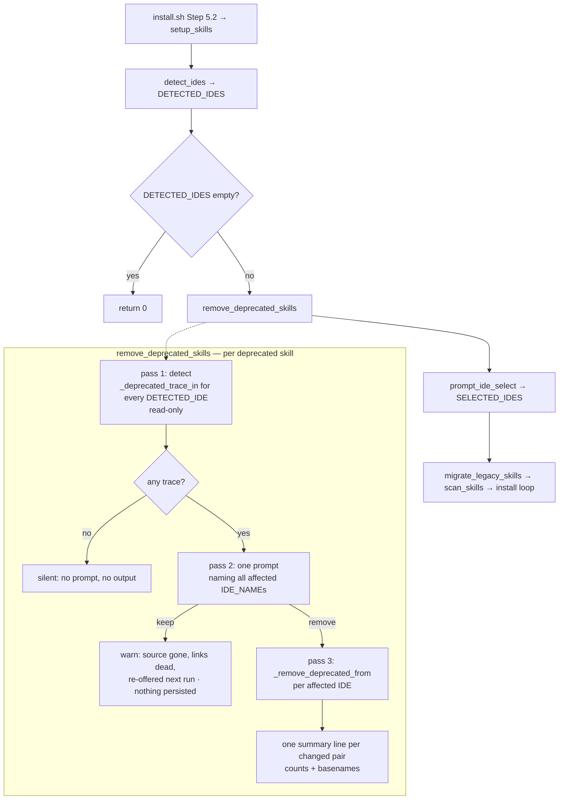
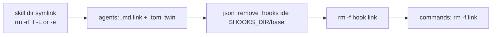

# DEV-306771 — Deprecate four skills: Design

**Spec**: `.specs/features/DEV-306771-deprecate-installer-skills/spec.md`
**Context**: `.specs/features/DEV-306771-deprecate-installer-skills/CONTEXT.md` — **authoritative** where it
contradicts the spec (see its "Spec Amendments Required Before Design" table)
**Status**: **Approved** — 2026-08-21. Architecture (§2) and all five open items resolved; see
§Approval record. Tasks: `.specs/features/DEV-306771-deprecate-installer-skills/tasks.md`
**Scope**: Large — approach exploration required before component detail

---

## Approval record — 2026-08-21

All five items listed under §Open items before Tasks are **decided**. They are settled; do not
re-litigate them in Tasks or Execute.

| Item | Decision | Where it lands |
| ---- | -------- | -------------- |
| **D-1** `uninstall.sh` aborts at `:63` (25 top-level `local`, zero functions, `set -euo pipefail`) — verified by execution, broken since `8ffd595` | **Approved: strip the 25 `local` keywords** as part of this feature (option 1). DEPR-13 stays in scope and becomes evidenceable | tasks.md **T10** (repair) → **T11** (wire) |
| **D-2** P1-4 AC 7 "byte-identical" registry | **Approved: reinterpret as entry-preserving.** Tests compare parsed `{event,matcher,command}` triples, never file bytes. Detection stays strictly read-only | tasks.md T4 (read-only assertion), T6 (triple comparison) |
| **D-3** DEPR-N03's "precedence bug" premise | **Acknowledged as factually wrong** — `A \|\| B && C` already parses as `(A\|\|B) && C`. Braced form adopted as explicit-grouping style only. **No task asserts a behaviour change at `:461,:473`** | tasks.md T6 |
| **D-6** Architecture | **Approved: Approach C** — 4 helpers + thin orchestrator, detection separated from mutation | tasks.md phases 1–4 |
| **AD-006 / AD-007** | **Approved: append both to `.specs/STATE.md`** | tasks.md **T16** |

Also carried forward, unchanged: **A-05 stays defaulted and undiscussed** — no `test:shell` runner.
`pnpm test` is `turbo run test` and never invokes `scripts/tests/*`; there is no CI. The new shell
suite is manual-only, so every gate in tasks.md names its `bash …` command explicitly.

---

## 0. Blocking findings — verified against the live tree

Four spec/context claims do **not** hold. Each was checked by execution, not read. Three of them
make a stated acceptance criterion literally unachievable as written. **All four are now resolved —
see §Approval record.**

### B1 — `scripts/uninstall.sh` is dead on arrival; DEPR-13 cannot be satisfied without fixing it

`scripts/uninstall.sh:10` sets `set -euo pipefail`, and `:63` uses `local` at **top level, outside
any function**. There are **25** such statements (`:63,64,65,71,77,83,84,96,102,124,125,129,161,
176,177,183,184,185,186,187,197,203,204,217,223`) and the file defines **zero** functions.

```
$ bash scripts/uninstall.sh --dry-run </dev/null; echo "EXIT=$?"
ia-framework Uninstaller
This will remove all ia-framework MCP configurations and skill links from all IDEs.
scripts/uninstall.sh: line 63: local: can only be used in a function
EXIT=1
```

The script aborts at line 63 — before the dry-run report, before `migrate_legacy_skills`, before
any removal. `git show 8ffd595:scripts/uninstall.sh` already had 7 of these, so **the uninstaller
has never worked**. Consequences:

- Spec P1-4 AC 3 ("`scripts/uninstall.sh` SHALL call `remove_deprecated_skills`") is satisfiable in
  source but **unobservable in behaviour** — the call would sit after an abort.
- The spec's own Success Criterion "`./scripts/uninstall.sh` on a seeded machine removes the
  deprecated assets rather than skipping them" is **unreachable**.
- Spec `Out of Scope` does not exclude this; it is a latent defect the feature's own AC trips over.

**Options** (resolved — recorded as **D-1** in §Tech Decisions):
1. **Strip the 25 top-level `local` keywords** (mechanical, ~25 single-word deletions, no logic
   change) so DEPR-13 becomes verifiable. Smallest change that makes a stated AC testable.
   ← **APPROVED 2026-08-21.** Implemented by tasks.md T10, wired by T11.
2. Wire the call and accept DEPR-13 as source-only, unverifiable. Rejected by the skill's
   evidence-or-zero gate — the Verifier cannot produce evidence for it.
3. Defer the uninstaller entirely: drop DEPR-13 from this feature, log a follow-up.

**Recommendation: option 1.** It is the only option under which DEPR-13's AC can be evidenced, and
the edit is mechanical (`local x=` → `x=`) with no behavioural surface beyond removing an abort.

### B2 — "byte-identical" registry preservation (P1-4 AC 7) is unachievable; `json_remove_hooks` rewrites the whole file

`json_remove_hooks` (`scripts/installer-helpers.sh:470-502`) unconditionally
`JSON.stringify(cfg, null, 2)` + `writeFileSync` — even when the filter removed nothing. Verified:

```
# seed a hand-formatted settings.json with one unrelated hook, remove a non-present command
$ json_remove_hooks claude-code /x/notpresent.js
$ diff orig.json settings.json
< { "hooks": [ { "type": "command", "command": "/x/keepme.js" } ] }
> {  "hooks": [ {  "type": "command", ... }  ] }     # re-indented
REFORMATTED
```

Entries are **semantically** preserved; the file is **not** byte-identical. In practice the live
registries were written by `json_merge_hooks` in the same 2-space form, so a real machine round-trips
unchanged — but any test that seeds a hand-written registry and byte-compares will fail, and
`json_remove_hooks` is existing code the spec's Out of Scope leaves untouched.

**Design resolution (D-2):** read P1-4 AC 7 as **entry-preserving, not byte-preserving** —
*"every hook-registry entry not matching a manifest hook path SHALL still be present, with its
`event`, `matcher` and `command` unchanged"*. Tests assert on parsed entries (`node -e` comparing
the set of `{event, matcher, command}` triples), never on file bytes. Additionally, detection
(§Components / `_registry_has_deprecated_entry`) is **read-only**: it never calls
`json_remove_hooks`, so an IDE with no trace has its registry left genuinely untouched — which is
what P1-4 AC 6 ("second run prints nothing") actually needs.

### B3 — NFR-03's "precedence bug" premise is factually wrong

Spec P1-4 AC 9 / DEPR-N03 requires the braced `{ [ A ] || [ B ]; } && rm` form "rather than the
unbraced precedence-bug idiom at `install-skills.sh:461,473`". `&&` and `||` have **equal
precedence and left-to-right associativity** in bash, so `A || B && C` already parses as
`(A || B) && C` — the intended semantics. Verified for all three cases:

| target state | unbraced result | braced result |
| --- | --- | --- |
| absent | `rm` not run, compound → 1 | identical |
| exists as file | `rm` runs | identical |
| under `set -e`, false branch | script survives (compound is not the last command) | identical |

There is no behavioural difference and no latent bug at `:461,:473`.

**Design resolution (D-3):** **comply with the requirement as written** — all new code uses the
braced form — but on the honest rationale: it is explicit-grouping style that silences
shellcheck's `SC2015` class of warning, **not** a bug fix. The design does not claim to fix a
defect that does not exist, and no task will assert a behaviour change at `:461,:473`.

### B4 — `read -rp`'s prompt is invisible under non-TTY stdin, so P1-3's Independent Test needs a different anchor

`man bash`: *"-p prompt — Display prompt on standard error … The prompt is displayed **only if input
is coming from a terminal**."* Verified — with piped stdin, stderr contained only the explicit
`echo >&2` line, 11 bytes, no bracket prompt:

```
$ tok=$(printf 'keep\n' | prompt_fn 2>err); cat err
PROSE-LINE            # the read -rp "  [remove/keep] (remove): " text is absent
$ echo "$tok"
keep
```

Separately, `is_noninteractive()` (`installer-helpers.sh:30`) is `! [ -t 0 ] || CI || NON_INTERACTIVE`
— **any** piped stdin makes it true. So `printf 'n\n' | remove_deprecated_skills` takes the
non-interactive branch and never prompts at all.

**Design resolution (D-4):** two constraints on the prompt component and its tests.
1. **Every asserted string lives in the explicit `echo … >&2` line** — skill name, the word
   `deprecated`, and all affected `IDE_NAME`s. The `read -rp` bracket carries only
   `[remove/keep] (remove): ` and is never asserted.
2. **Tests exercise the interactive path by shadowing `is_noninteractive` to return 1**, using the
   same shadowing precedent already established for `source_ide_descriptor`
   (`scripts/tests/migrate-legacy-skills.test.sh:50-54`). Input is fed on stdin as usual.

---

## 1. What the live tree actually holds (blast radius)

CONTEXT.md documents OpenCode only. Verified live, 7 IDEs detected (`detect_ides` →
`opencode claude-code codex cursor gemini vscode-copilot windsurf`):

| IDE | skill dirs | agents | commands | hook files | registry entries |
| --- | --- | --- | --- | --- | --- |
| opencode | 4 `linked` | 4 links | 9 links (+3 `mcp-bench`) | 9 links | n/a |
| claude-code | **0** (only `mcp-bench`) | 4 links | 0 (only `mcp-bench`) | **0 — dir empty** | **9 deprecated / 9 total** |
| codex | 0 (`~/.agents/skills` → `mcp-bench` only) | 4 **real `.toml`** files | n/a (`IDE_COMMANDS_DIR=""`) | 9 real files | **9 deprecated / 9 total** |
| cursor | 4 `linked` | 4 links | n/a | n/a | n/a |
| gemini | 4 `linked` | 4 links | n/a | n/a | n/a |
| vscode-copilot | n/a (`IDE_SKILLS_DIR=""`) | 4 links in `~/.github/agents` | n/a | n/a | n/a |
| windsurf | 4 `linked` | 4 links | n/a | n/a | n/a |

Three spec/context claims are corrected by this:

- **Removal reaches 7 IDEs, not 1.** `DEPR-06`'s `DETECTED_IDES` iteration is doing real work here;
  a `SELECTED_IDES` loop would miss 6 of 7.
- **`claude-code` is live proof of A-06.** Zero files in `~/.claude/hooks`, yet 9 deprecated
  `h.command` entries in `~/.claude/settings.json` — the orphaned-registry case is not
  hypothetical, it is this machine's current state. Without registry-aware detection, `claude-code`
  is never named in the prompt and those 9 entries survive forever.
- **`vscode-copilot` is live proof of A-10.** `IDE_SKILLS_DIR=""` but 4 real agent links in
  `~/.github/agents`.
- `codex` `.toml` agents are **real files, not symlinks** (`-rw-r--r-- refuter-analyst.toml`),
  confirming DEPR-09's twin removal is required, not defensive.

## 1.1 Manifest verified from history

`git log --all --diff-filter=A` over each skill's `agents/`, `commands/`, `hooks/` reproduces the
spec's lists **exactly** — 0 / 4 / 11 / 14 assets. The current tree is strictly smaller
(`tlc-spec-driven` ships 7 commands and 0 agents today vs 13 commands + 1 agent historically), which
is precisely why the manifest must be history-based rather than globbed.

## 1.2 Environment constraints (verified)

- `bash 3.2.57` — **no associative arrays** (`declare -A` → "invalid option"). And under `set -u`,
  iterating an empty array (`for x in "${a[@]}"`) is a fatal *unbound variable*, while
  `${#a[@]}` is safe. Every new loop must either count-guard first or use `${a[@]:-}`.
  `migrate_legacy_skills` sidesteps this with `for rel in $assets` over a **string** — the design
  follows that precedent.
- `node` present; it is the only external tool on the write path.
- Existing suites green before this feature: `install-skills-state` 5/0, `migrate-legacy-skills`
  4/0, `refuter-drift-detector` 4/0.

---

## 2. Architecture

### Approach exploration

All three deliver the same scoped outcome; they differ in decomposition.

**Approach A — monolithic mirror of `migrate_legacy_skills`.** One `remove_deprecated_skills()`
containing detect, prompt and apply inline, one `DETECTED_IDES` loop per phase.

- **+** Closest to the file's dominant idiom; smallest diff.
- **−** Detection is not callable without mutating, so P2-2 AC 3's seven required branch cases
  (toml twin, orphan purge, trace-vs-no-trace, absent source, decline, idempotency, allowlist) can
  only be tested through the destructive top-level entry point. Every test becomes an end-to-end
  sandbox run; a detection regression surfaces as a confusing removal-count mismatch.

**Approach B — extract a shared `_purge_skill_assets()` used by both `migrate_legacy_skills` and
the new routine.** **Rejected** — spec Out of Scope excludes it explicitly, and CONTEXT.md notes the
consent gate, CI carve-out and `DETECTED_IDES` departure *widen* the behavioural gap. Also
`install-skills.sh:57`'s guard was already fixed once in production (`70cb8b8`); touching that
routine now risks a second regression for no requirement.

**Approach C (recommended) — three-helper decomposition + thin orchestrator.** Same per-IDE
descriptor dance as A, but detection is a **pure, read-only query** separated from mutation:

```
_deprecated_assets_for  NAME              → manifest string          (pure)
_deprecated_trace_in    NAME IDE          → 0/1 + $TRACE_STATE        (read-only)
_remove_deprecated_from NAME IDE          → 0 + counts + basenames    (mutator)
remove_deprecated_skills                  → detect → prompt → apply   (orchestrator)
```

- **+** Every branch in P2-2 AC 3 is unit-testable without `rm`. Detection can be asserted against
  a seeded registry-only IDE (the `claude-code` case) with zero destructive risk.
- **+** Read-only detection is what makes P1-4 AC 6 ("second run prints nothing") true by
  construction: nothing is written when nothing is found — see D-2.
- **+** The mutator is the only function that deletes, so DEPR-N04's "manifest-listed paths only"
  is enforceable by inspecting one function.
- **−** Four functions instead of one (~40 more lines than A).

**Chosen: C.** The extra decomposition is paid back directly by the test matrix the spec already
requires, on a destructive `rm` path.

### Flow



Per-IDE removal order inside `_remove_deprecated_from` (order is itself a requirement):



`json_remove_hooks` **before** `rm -f` (P1-2 AC 7) — it matches on exact string equality of
`h.command`, so the absolute path must still be computable; and it is called **even when the link is
already absent** (P1-2 AC 9), which is the `claude-code` orphan case from §1.

---

## 3. Code Reuse Analysis

### Existing components to leverage

| Component | Location | How to use |
| --- | --- | --- |
| `migrate_legacy_skills` | `scripts/install-skills.sh:56-129` | **Structural template.** Copy the per-IDE source/unset dance (`:68-77`), the `for rel in $assets` string loop (`:91`), the `agents/` `.md`+`.toml` twin block (`:96-99`), the `json_remove_hooks`-then-`rm` ordering with its link-absent `else` branch (`:110-118`), and the one-summary-line-per-pair guard (`:123-125`). Do **not** modify it. |
| `_legacy_assets_for` | `scripts/install-skills.sh:32-48` | Exact shape precedent for `_deprecated_assets_for`: `case`/`echo` one space-separated line, `*) echo ""` for unknown. Disjoint basenames (`tab-*` vs un-prefixed) → both registries compose, A-03 verified. |
| `detect_link_state` | `scripts/installer-helpers.sh:359-370` | Skill-dir state → `linked\|broken\|copied\|absent`. Drives P1-2 AC 4 and the `copied` carve-out. Reuse verbatim; do not re-implement the `-L`/`-e` logic. |
| `json_remove_hooks` | `scripts/installer-helpers.sh:470-502` | Deregistration. Already fails closed on malformed JSON (`catch { process.exit(0) }`) and no-ops on a missing file (`:481`) and on non-`claude-code`/`codex` IDEs (`:478`) — that is DEPR-N01's external-dependency coverage, reused rather than rebuilt. See B2 for its rewrite side-effect. |
| `source_ide_descriptor` | `scripts/installer-helpers.sh:344-353` | Per-IDE dir resolution. Always `|| continue` (Edge Case) and always follow with the 12-var `unset` block, or `IDE_*` leaks across iterations. |
| `is_noninteractive` | `scripts/installer-helpers.sh:30-32` | CI / no-TTY gate for the `copied` carve-out. See B4 — tests must shadow it. |
| `prompt_skill_action` | `scripts/install-skills.sh:667-730` | Prompt idiom: prose via `echo -e … >&2`, `read -rp` with default in parens, decision token to stdout, `tr '[:upper:]' '[:lower:]'` normalisation. |
| `scan_skills` | `scripts/install-skills.sh:135-157` | Extended, not replaced: the `node`-based `.name` read (`:147-154`) already satisfies P1-1 AC 3; only an allowlist membership test is added. |
| Shell-test harness | `scripts/tests/migrate-legacy-skills.test.sh` | Copy wholesale: `mktemp` sandbox + `trap`, `export SCRIPT_DIR`/`HOME`/`XDG_CONFIG_HOME`, real descriptors copied in, shadowed `source_ide_descriptor` (`:50-54`), `tN()` fns, `pass`/`fail` counters, `set -u` only, `[ "$FAIL" -eq 0 ]` exit. |

### Integration points

| System | Integration method |
| --- | --- |
| `install.sh` Step 5.2 | Unchanged. `setup_skills "${SCRIPT_DIR}"` at `:222`, already `\|\| echo warn`-guarded. |
| `setup_skills` | One new call **between `:752` and `:754`** — after the `DETECTED_IDES`-empty return, before `prompt_ide_select`. Verified: `migrate_legacy_skills` at `:764` is *after* the `SELECTED_IDES`-empty return at `:757-760`, so the same spot would be unreachable when no IDE is selected. |
| `scripts/uninstall.sh` | One call **before** the per-descriptor loop (`:179`), not inside it — see D-5. Gated on B1. |
| `~/.claude/settings.json`, `~/.codex/hooks.json` | Only via `json_remove_hooks`. No new JSON writer. |
| MCP configuration | **Untouched** (`install.sh:205-216`). Out of scope. |
| `packages/cli/src/commands/agents.command.ts` | Its generated `ia-framework:rag` block in `AGENTS.md` (`:9-319`) must not be hand-edited. Note: it **precedes** the `pipeline-guide` block (`:321-359`) — spec P2-1 AC 2 says "follows"; CONTEXT.md's correction is right. |

---

## 4. Components

### `OFFICIAL_SKILLS` — allowlist (DEPR-01)

- **Purpose**: the single source of truth for which skills may be distributed.
- **Location**: `scripts/install-skills.sh`, top-level next to `LEGACY_SKILL_RENAMES` (~`:26`).
- **Interface**: `OFFICIAL_SKILLS=("mcp-bench")` — a plain indexed array (bash 3.2: no `declare -A`).
- **Dependencies**: none.
- **Reuses**: nothing; new data.
- **Note**: membership is tested by the `[[ " ${OFFICIAL_SKILLS[*]} " == *" $name "* ]]` idiom
  already used for `DETECTED_IDES` at `installer-helpers.sh:306`.

### `scan_skills` (modified) — allowlist filter (DEPR-01)

- **Purpose**: populate `AVAILABLE_SKILLS` with allowlisted skills only.
- **Location**: `scripts/install-skills.sh:135-157`.
- **Change**: after the existing `.name` read (`:147-155`), replace
  `[ -n "$name" ] && AVAILABLE_SKILLS+=("$name")` with a membership guard. Non-allowlisted →
  skipped silently, **no error, no warning** (P1-1 AC 2).
- **Dependencies**: `node`, `SCRIPT_DIR`.
- **Reuses**: the entire existing glob + `.name` parse. `.name`-not-directory-name (P1-1 AC 3) is
  already how it works.
- **Preserved**: missing `skills/` → warn + `return 0` (`:139-142`).

### `DEPRECATED_SKILLS` + `_deprecated_assets_for` — manifest (DEPR-03, DEPR-04)

- **Purpose**: name the four skills and their history-derived asset sets, independent of the deleted
  source tree.
- **Location**: `scripts/install-skills.sh`, immediately after `_legacy_assets_for` (~`:49`).
- **Interfaces**:
  - `DEPRECATED_SKILLS=("grill-with-docs" "jira-feed" "refuter" "tlc-spec-driven")`
  - `_deprecated_assets_for NAME` → **stdout**: one space-separated line of `agents/`-, `commands/`-
    or `hooks/`-prefixed relative paths; empty string for an unknown name and for `grill-with-docs`.
- **Dependencies**: none — pure `case`/`echo`, no filesystem, no `node`.
- **Reuses**: `_legacy_assets_for`'s exact shape.
- **Contents** (verified `git log --all --diff-filter=A`, §1.1):

| Skill | agents | commands | hooks |
| --- | --- | --- | --- |
| `grill-with-docs` | — | — | — |
| `jira-feed` | `jira-feed-formatter.md` | `jira-feed.md` | `jira-feed-jira-guard.js`, `jira-feed-output-guard.js` |
| `refuter` | `refuter-analyst.md`, `refuter-orchestrator.md`, `refuter-report-writer.md` | `refuter.md` | `refuter-audit-trail.js`, `refuter-citation-verifier.js`, `refuter-convergence.js`, `refuter-drift-detector.js`, `refuter-evidence-guard.js`, `refuter-learning-append.js`, `refuter-orchestration-complete.js` |
| `tlc-spec-driven` | `tlc-specify-runner.md` | `delivery.md`, `start-work-on.md`, `tlc-design.md`, `tlc-discuss.md`, `tlc-execute.md`, `tlc-map-codebase.md`, `tlc-project-init.md`, `tlc-quick.md`, `tlc-roadmap.md`, `tlc-session.md`, `tlc-specify.md`, `tlc-state.md`, `tlc-tasks.md` | — |

  No basename collides with `mcp-bench`'s `mcp-bench-{baseline,judge,run}.md` (Edge Case verified).

### `_deprecated_trace_in` — read-only detection (DEPR-06, A-06, A-10)

- **Purpose**: answer "does this IDE hold a trace of this skill?" **without writing anything**.
- **Location**: `scripts/install-skills.sh`, after `_deprecated_assets_for`.
- **Interface**: `_deprecated_trace_in NAME IDE_ID` → exit `0` = trace, `1` = none; sets global
  `TRACE_STATE` ∈ `linked|broken|copied|files|registry` (`files` = assets present but no skill dir;
  `registry` = registry-only orphan). Ordering matters: a `copied` skill dir dominates, since it
  alone triggers the CI carve-out.
- **Dependencies**: `source_ide_descriptor`, `detect_link_state`, `node` (registry read only).
- **Reuses**: `detect_link_state` for the skill dir; `migrate_legacy_skills`' asset-kind `case`
  shape for the per-file checks.
- **Detection order**:
  1. `IDE_SKILLS_DIR` non-empty → `detect_link_state "$dir/$NAME"`; `linked|broken|copied` = trace
     (P1-2 AC 4). Empty `IDE_SKILLS_DIR` is skipped, not an error (P1-2 AC 5, `vscode-copilot`).
  2. Any manifest asset present (`-L` or `-e`) in `IDE_AGENTS_DIR`/`IDE_COMMANDS_DIR`/
     `IDE_HOOKS_DIR`, **including the `.toml` twin** → `files`.
  3. Registry-only: `claude-code`/`codex` only — grep the parsed registry for any manifest hook's
     absolute path → `registry` (A-06; live on `claude-code` per §1).
- **Registry read**: a new `_registry_has_deprecated_entry IDE_ID PATHS…` helper — one `node`
  invocation per (IDE, skill) on the two hook-capable IDEs, **read-only**, `catch → exit 1` so
  malformed JSON reads as "no trace" rather than aborting (DEPR-N01). It must **not** call
  `json_remove_hooks`, which would rewrite the file during detection (B2).
- **Cost**: ≤ 8 extra `node` invocations per run (2 IDEs × 4 skills), accepted in CONTEXT.md.

### `_remove_deprecated_from` — the only mutator (DEPR-08, DEPR-09, DEPR-10, DEPR-N04)

- **Purpose**: remove one skill's every trace from one IDE and report what changed.
- **Location**: `scripts/install-skills.sh`, after `_deprecated_trace_in`.
- **Interface**: `_remove_deprecated_from NAME IDE_ID` → always `0`; sets globals
  `RM_LINKS` (int), `RM_HOOKS` (int), `RM_NAMES` (space-separated basenames, for the summary line).
- **Dependencies**: `source_ide_descriptor`, `json_remove_hooks`.
- **Reuses**: `migrate_legacy_skills:81-121` almost verbatim — the skill-dir `rm -rf` under
  `{ [ -L ] || [ -e ]; }`, the `.md` + `.toml` agent pair, the hook `json_remove_hooks`-then-`rm -f`
  with the link-absent `else` branch that still deregisters.
- **Invariants**:
  - Writes only to `IDE_SKILLS_DIR`/`IDE_AGENTS_DIR`/`IDE_COMMANDS_DIR`/`IDE_HOOKS_DIR` of the seven
    known descriptors, and only for manifest basenames — no developer-supplied path ever reaches
    `rm` (DEPR-N04; the manifest is a closed `case` literal).
  - Empty `IDE_*_DIR` → that asset kind is skipped, no error (`codex`/`vscode-copilot` commands,
    the four hook-less IDEs).
  - Braced `{ [ A ] || [ B ]; } && rm …` everywhere (DEPR-N03, per D-3).
  - `for rel in $assets` — string word-splitting, **not** an array, avoiding the bash 3.2
    empty-array-under-`set -u` fatal (§1.2).

### `_prompt_deprecated_removal` — consent (DEPR-07, DEPR-11, DEPR-14)

- **Purpose**: one decision per skill, covering all affected IDEs.
- **Location**: `scripts/install-skills.sh`, after `_remove_deprecated_from`.
- **Interface**: `_prompt_deprecated_removal NAME STATE IDE_NAMES_LABEL` → **stdout**: `remove` or
  `keep`. All prose to **stderr**.
- **Dependencies**: `is_noninteractive`.
- **Reuses**: `prompt_skill_action`'s idiom exactly.
- **Behaviour**:
  - `is_noninteractive` → no prompt; `remove` for `linked|broken|files|registry`; **`keep` +
    warning for `copied`** (A-01 / CONTEXT.md CI carve-out — the one place unattended destruction
    would be irreversible).
  - Interactive: one stderr line then `read -rp "  [remove/keep] (remove): "`. **Empty line →
    `remove` uniformly**, including `copied` (CONTEXT.md overrides spec P1-3 AC 8 / A-08).
  - The **entire asserted payload is in the stderr `echo`** (B4/D-4) — skill name, the word
    `deprecated`, every affected `IDE_NAME`:
    `• refuter — deprecated, found in OpenCode, Claude Code, Codex`
  - `copied` variant additionally states the absolute path, that it is a **real directory, not a
    link**, and that removal is permanent because the content is **not in this repo's git history**.
  - `keep` → warning naming *both* causes: source gone from the repo so links are dead, **and**
    it will be re-offered next run. **Nothing written to disk** (DEPR-14; no state file exists).

### `remove_deprecated_skills` — orchestrator (DEPR-05, DEPR-12, DEPR-N01, DEPR-N02, DEPR-N06)

- **Purpose**: the single public entry point; three passes per skill.
- **Location**: `scripts/install-skills.sh`, before `scan_skills`.
- **Interface**: `remove_deprecated_skills` — no args, **always `return 0`** (DEPR-05 / P1-2 AC 10).
- **Dependencies**: `DETECTED_IDES` and the four helpers. **Never reads `SELECTED_IDES`**
  (DEPR-06 / P1-4 AC 2) — enforced by not naming the variable in the function at all.
- **Reuses**: `migrate_legacy_skills`' loop skeleton and summary-line guard.
- **Behaviour**:
  - `{ [ "${DETECTED_IDES+set}" = set ] && [ "${#DETECTED_IDES[@]}" -gt 0 ]; } || return 0` —
    the `install-skills.sh:57` guard shape (already production-hardened by `70cb8b8`), adapted.
    Required for bash 3.2 `set -u` (§1.2).
  - Pass 1 detect → pass 2 one prompt → pass 3 apply. No trace ⇒ **no prompt and no output**
    (P1-3 AC 7, P1-4 AC 6).
  - One summary line **per changed (skill, IDE) pair**, carrying counts **and** basenames
    (CONTEXT.md tightens DEPR-N06); nothing printed for an unchanged pair. Extends the
    `↻ migrated …` precedent at `:124`:
    `✓ removed refuter from Claude Code (4 link(s), 7 hook registration(s): refuter-analyst.md, …)`

### `setup_skills` (modified) — installer wiring (DEPR-12)

- **Location**: `scripts/install-skills.sh:738-862`.
- **Change**: insert `remove_deprecated_skills` between `:752` and `:754` — after the
  `DETECTED_IDES`-empty `return 0`, before `prompt_ide_select`. Nothing else changes.

### `scripts/uninstall.sh` (modified) — uninstaller wiring (DEPR-13)

- **Change**: one `remove_deprecated_skills || true` **before** the per-descriptor loop at `:179`,
  preceded by `detect_ides` to populate `DETECTED_IDES`. Not inside the loop — see D-5.
- **Gated on B1/D-1**: without the top-level-`local` fix the call is unreachable.

### Repository cleanup (DEPR-02, DEPR-15, DEPR-17)

- Delete `skills/{grill-with-docs,jira-feed,refuter,tlc-spec-driven}/` — `skills/` then holds only
  `mcp-bench/` (P1-1 AC 4).
- `AGENTS.md`: delete `:321-359` **including both markers**. Leave `:9-319` (generated) untouched.
- `README.md:733`: drop the `jira-feed` sentence.
- Delete `scripts/tests/refuter-drift-detector.test.js` and
  `scripts/tests/refuter-orchestration-complete.test.js` (they resolve `../../skills/refuter/hooks/*.js`
  at `:17` / `:24`; both currently pass, and both break the moment DEPR-02 lands).
- **Leave alone** (intentional historical/unrelated mentions, per P2-1's Independent Test):
  `install-skills.sh:27-39` (`tab-*` legacy registry), `install-speckit.sh:7` (retired-script
  comment), `install-opencode.sh:278,409` (worktree path comments — the directory layout is real and
  outlives the skill), `scripts/tests/migrate-legacy-skills.test.sh` (self-contained `refuter`
  fixture in its own sandbox, no repo path).

### Local materialization (DEPR-16) — one-off, sequenced first

Per CONTEXT.md, **narrower than spec P3**: only `tlc-spec-driven` survives.

- `~/.config/opencode/skills/tlc-spec-driven/` → real directory, same name, pre-deletion content.
- 5 real files in `~/.config/opencode/command/`: `tlc-{specify,design,tasks,execute,discuss}.md`.
- Delete `command/{delivery.md,start-work-on.md}`.
- `grill-with-docs`, `jira-feed`, `refuter` get **no copy** — their links and registrations are
  removed by the shipped path, making this machine a live test of it.
- `mcp-bench`'s links (1 skill dir + 3 commands) stay untouched symlinks.
- **Must be task #1.** This session's `/tlc-design`, `/tlc-tasks`, `/tlc-execute` all resolve
  through the symlink that DEPR-02 deletes.
- Accepted: the copy is `copied` state → prompted on every future run; answer `keep`.

---

## 5. Data Models

The manifest is the only data structure. Bash 3.2 has no associative arrays, so it is a function
returning a space-separated string — the `_legacy_assets_for` precedent:

```bash
# Space-separated, kind-prefixed relative paths. Empty line for unknown names.
# Union of every asset ever shipped (git log --all --diff-filter=A), NOT the current tree:
# the source directories are deleted by DEPR-02, so a glob would find nothing.
_deprecated_assets_for() {
  case "$1" in
    grill-with-docs) echo "" ;;
    jira-feed)       echo "agents/jira-feed-formatter.md commands/jira-feed.md \
hooks/jira-feed-jira-guard.js hooks/jira-feed-output-guard.js" ;;
    refuter)         echo "agents/refuter-analyst.md …" ;;
    tlc-spec-driven) echo "agents/tlc-specify-runner.md commands/delivery.md …" ;;
    *)               echo "" ;;
  esac
}
```

**Relationship to `LEGACY_SKILL_RENAMES`**: disjoint basename sets (`tab-refuter-*` vs `refuter-*`),
so both registries run in sequence without conflict (A-03, verified).

**Trace lattice** — `detect_link_state`'s four states extended by two asset-only states:

```
linked ─┐
broken ─┼→ trace  → prompt → {remove → removed, keep → retained}
copied ─┤          (copied: CI ⇒ retained, never removed)
files  ─┤
registry┘
absent  →  no trace  → silent
```

---

## 6. Error Handling Strategy

| Scenario | Handling | User impact |
| --- | --- | --- |
| Broken skill-dir symlink | `detect_link_state` → `broken` = trace; `rm -rf` under `{ -L \|\| -e }` | Removed; no error |
| Deprecated source dir absent from repo (the normal post-DEPR-02 case) | Manifest is hardcoded; nothing globs `skills/<name>/` | Removed silently (P1-4 AC 4) |
| Registry file missing | `json_remove_hooks:481` `[ -f ] \|\| return 0`; detection helper `catch → exit 1` | Continue; file not created |
| Registry malformed / `node` fails | `json_remove_hooks:490` `catch { process.exit(0) }` — no write; detection reads "no trace" | Continue, exit 0 (P1-4 AC 5) |
| `IDE_SKILLS_DIR=""` | Skip step 1, still check assets | `vscode-copilot` handled (P1-2 AC 5) |
| `IDE_COMMANDS_DIR=""` / `IDE_HOOKS_DIR=""` | Skip that asset kind | `codex`, `cursor`, `gemini`, `windsurf`, `vscode-copilot` (Edge Cases) |
| `source_ide_descriptor` fails | `\|\| continue` | IDE skipped, loop proceeds |
| `DETECTED_IDES` unset/empty | Guard → `return 0` before any loop | Silent; also prevents the bash 3.2 `set -u` fatal |
| Hook never registered (no inferable event) | `json_remove_hooks` filters nothing | Harmless no-op |
| Registry group empties after removal | Existing `.filter(group => length > 0)` prunes it; unrelated groups kept | Must not regress |
| Manifest asset is a real file, not a link (codex `.toml`) | `{ [ -L ] \|\| [ -e ]; }` covers both | Removed |
| Partial failure (IDE 1 ok, IDE 2 fails) | Continue; IDE 1 stays clean | Re-run finishes the job (DEPR-N02) |
| `copied` under `is_noninteractive` | Skipped with a warning, never removed | Unversioned local work preserved (A-01) |
| Concurrent `install.sh` runs | No lock (out of scope); all ops idempotent | Interleaving degrades to a repeat, not corruption |

---

## 7. Risks & Concerns

| Concern | Location | Impact | Mitigation |
| --- | --- | --- | --- |
| **`uninstall.sh` aborts at line 63** — 25 top-level `local` under `set -euo pipefail`, zero functions; broken since `8ffd595` | `scripts/uninstall.sh:63` (+24 more) | DEPR-13 unverifiable; the spec's uninstaller Success Criterion unreachable; the whole uninstaller is dead for every user | **D-1 approved 2026-08-21**: strip the 25 `local` keywords (mechanical) so the AC can be evidenced. Deliberately accepted as adjacent to, not inside, the ticket's scope — tasks.md T10 |
| **`json_remove_hooks` rewrites the registry even on a no-op match** | `scripts/installer-helpers.sh:500` | P1-4 AC 7's literal "byte-identical" is unachievable; a naive test would fail on formatting | **D-2**: AC read as entry-preserving; tests compare parsed `{event,matcher,command}` triples. Detection kept strictly read-only so no-trace IDEs are never written |
| **`read -rp` prompt invisible under non-TTY**, and `is_noninteractive` is true for any pipe | `installer-helpers.sh:30`; bash `read -p` semantics | P1-3's Independent Test as written can never observe a prompt | **D-4**: all asserted text in the explicit `echo >&2`; tests shadow `is_noninteractive` (precedent: `migrate-legacy-skills.test.sh:50`) |
| **bash 3.2**: iterating an empty array under `set -u` is fatal; no `declare -A` | `/bin/bash 3.2.57`; `install-skills.sh:57` shows the guard already needed once (`70cb8b8`) | A no-IDE or no-asset run would abort mid-install | Count-guard before every new loop; manifest as a **string** with `for rel in $assets`; reuse the `:57` guard shape verbatim |
| **`migrate_legacy_skills` duplication** — ~45 near-identical lines | `install-skills.sh:56-129` vs the new mutator | Two places to fix a future asset-kind bug | Accepted: refactor is explicitly Out of Scope, and the consent gate + CI carve-out + `DETECTED_IDES` widen the gap. `install-skills.sh:57` was already broken once by touching this routine |
| **Removal blast radius is 7 IDEs, not the 1 documented** — `cursor`/`gemini`/`windsurf` each hold 4 linked skill dirs; `claude-code` holds 9 orphaned registry entries with an empty hooks dir | live `$HOME`, §1 | A test/UAT written against OpenCode only would miss 6 IDEs and the entire orphan path | §1 table is the UAT baseline. `claude-code` is the natural orphan-purge fixture (P2-2 AC 3) |
| **Destructive `rm -rf` on a developer-authored `copied` directory** | new mutator | Irreversible loss of unversioned work | Closed manifest (no dynamic paths); `is_noninteractive` never removes `copied`; interactive `copied` prompt states path + "real directory, not a link" + "not in git history" |
| **The skill executing this feature deletes itself** (`skills/tlc-spec-driven/`) | `DEPR-02` vs `~/.config/opencode/skills/tlc-spec-driven` → repo symlink | `/tlc-tasks` and `/tlc-execute` break mid-flight | DEPR-16 materialization is **task #1**, before any deletion. Verify with `readlink` empty + `SKILL.md` present |
| **`AGENTS.md` generated block adjacent to the hand-edited one** | `AGENTS.md:9-319` generated by `packages/cli/src/commands/agents.command.ts:7`; hand block at `:321-359` | An over-broad edit is silently reverted on next `ia agents` run | Delete exactly `:321-359` incl. markers; diff `:9-319` byte-for-byte after the edit |
| **Deleting the two `refuter` JS tests removes 8 currently-passing assertions** | `scripts/tests/refuter-{drift-detector,orchestration-complete}.test.js` | Net coverage loss if the new shell tests are thin | Both test deleted hooks — retaining them is impossible. New shell suite must cover all 7 branches in P2-2 AC 3 |
| **No CI**: `scripts/tests/*.test.sh` are manual only | no `.github/`; `package.json test` = `turbo run test` | New tests can rot unnoticed | Accepted (A-05, undiscussed default). Logged as a follow-up, not resolved here |

---

## 8. Tech Decisions

| Decision | Choice | Rationale |
| --- | --- | --- |
| **D-1** `uninstall.sh` top-level `local` | **Strip the 25 `local` keywords** as part of this feature — **APPROVED 2026-08-21** (tasks.md T10) | Without it DEPR-13's AC cannot be evidenced and the uninstaller stays dead. Mechanical, no logic change. Alternatives considered and rejected: ship unverifiable, or drop DEPR-13 |
| **D-2** "byte-identical" registry (P1-4 AC 7) | Reinterpret as **entry-preserving**; detection is read-only | `json_remove_hooks:500` unconditionally re-stringifies. Verified empirically. Read-only detection also makes P1-4 AC 6 true by construction |
| **D-3** Braced `{ [ A ] \|\| [ B ]; } && rm` (DEPR-N03) | **Comply**, but on style grounds | Verified: `A \|\| B && C` already parses as `(A\|\|B) && C`; there is **no** precedence bug at `:461,:473`. Adopted for explicit grouping / shellcheck cleanliness. No task will claim a bug fix there |
| **D-4** Prompt-text placement | All asserted strings in the `echo … >&2` line; tests shadow `is_noninteractive` | `read -rp` suppresses its prompt on non-TTY stdin, and any pipe makes `is_noninteractive` true. Otherwise P1-3 is untestable |
| **D-5** Uninstaller call site | **Once, before** the per-descriptor loop (`:179`), after a `detect_ides` call | The loop sets `SELECTED_IDES=("$ide_id")` per IDE for `migrate_legacy_skills`; calling a `DETECTED_IDES`-wide routine inside it would run 7× and emit 7× the output. Uninstall intent is all-IDEs anyway |
| **D-6** Architecture | **Approach C** — 4 helpers + orchestrator, detection separated from mutation | The 7 branch cases P2-2 AC 3 requires are otherwise only reachable through a destructive entry point. Confines all `rm` to one auditable function (DEPR-N04) |
| **D-7** Manifest representation | Function returning a space-separated string | bash 3.2 has no associative arrays; and `for rel in $assets` avoids the empty-array-under-`set -u` fatal. Matches `_legacy_assets_for` |
| **D-8** Allowlist location | `OFFICIAL_SKILLS` array in `install-skills.sh` | Keeps the closed set beside `LEGACY_SKILL_RENAMES` and the deprecated registry — one file to read to know what ships |

> **Project-level decisions — APPROVED 2026-08-21.** Appended to `.specs/STATE.md` `## Decisions`
> by tasks.md **T16**:
> - **AD-006 — Distributable skills are governed by a closed allowlist.** A directory in `skills/`
>   is not distributed unless its `skill.json` `.name` appears in `OFFICIAL_SKILLS`. Adding a skill
>   is a deliberate two-place edit. *(Constrains every future skill.)*
> - **AD-007 — Removing a shipped asset requires a permanent hardcoded manifest entry.** Cleanup
>   must never glob the source tree for assets whose source is being deleted, and unattended
>   (`is_noninteractive`) runs must never delete a `copied`/real directory. *(Constrains every future
>   rename/deprecation, alongside `LEGACY_SKILL_RENAMES`.)*

---

## 9. Requirement coverage

| Req | Component |
| --- | --- |
| DEPR-01 | `OFFICIAL_SKILLS` + `scan_skills` |
| DEPR-02 | Repository cleanup |
| DEPR-03, DEPR-04 | `DEPRECATED_SKILLS` + `_deprecated_assets_for` |
| DEPR-05, DEPR-N01, DEPR-N02, DEPR-N06 | `remove_deprecated_skills` |
| DEPR-06, and A-06/A-10 | `_deprecated_trace_in` + `_registry_has_deprecated_entry` |
| DEPR-08, DEPR-09, DEPR-10, DEPR-N03, DEPR-N04 | `_remove_deprecated_from` |
| DEPR-07, DEPR-11, DEPR-14 | `_prompt_deprecated_removal` |
| DEPR-12 | `setup_skills` (modified) |
| DEPR-13 | `scripts/uninstall.sh` (modified) — **D-1 approved**: the top-level-`local` repair is tasks.md T10, the wiring is T11 |
| DEPR-15, DEPR-17 | Repository cleanup |
| DEPR-16 | Local materialization (task #1) |
| DEPR-N05 | `scripts/tests/remove-deprecated-skills.test.sh` + `scripts/tests/uninstall-deprecated-skills.test.sh` (both new; harness copied from `migrate-legacy-skills.test.sh`). **Split refined at Tasks:** `uninstall.sh` has top-level statements and zero functions, so it cannot be sourced by the source-and-call harness — it is exec'd as a subprocess in its own file |

23/23 requirements mapped. Test matrix for DEPR-N05 (P2-2 AC 3) — 7 minimum cases: allowlist
filtering incl. an unsanctioned `skill.json`; `.toml` agent twin (`codex`); orphaned registry purge
with **no** link present (`claude-code`); trace-vs-no-trace across two IDEs; manifest-driven removal
with the source directory **absent**; the decline path (shadowed `is_noninteractive`); idempotent
second run printing nothing.

Tasks expands these 7 minimum cases to **41 assertions across 16 tasks** — see
`tasks.md` → Test Coverage Matrix and Requirement Traceability.

---

## Open items before Tasks — ALL RESOLVED 2026-08-21

Kept for the record. See §Approval record at the top for the decision table.

1. ~~**D-1** — approve stripping `uninstall.sh`'s 25 top-level `local` keywords, or drop DEPR-13.~~
   → **Approved: strip them.** tasks.md T10.
2. ~~**D-2** — approve reinterpreting P1-4 AC 7 as entry-preserving rather than byte-identical.~~
   → **Approved.** Tests compare parsed triples; detection is read-only.
3. ~~**D-3** — acknowledge that DEPR-N03's "precedence bug" premise is wrong; the braced form is
   adopted as style.~~ → **Acknowledged.** No task claims a fix at `:461,:473`.
4. ~~**D-6** — approve Approach C over the monolithic Approach A.~~ → **Approved: Approach C.**
5. ~~**AD-006 / AD-007** — approve appending to `.specs/STATE.md`.~~ → **Approved.** tasks.md T16.

**Next step:** `/tlc-execute` — 16 tasks, 3 batches. T1 (local materialization) must run first.
